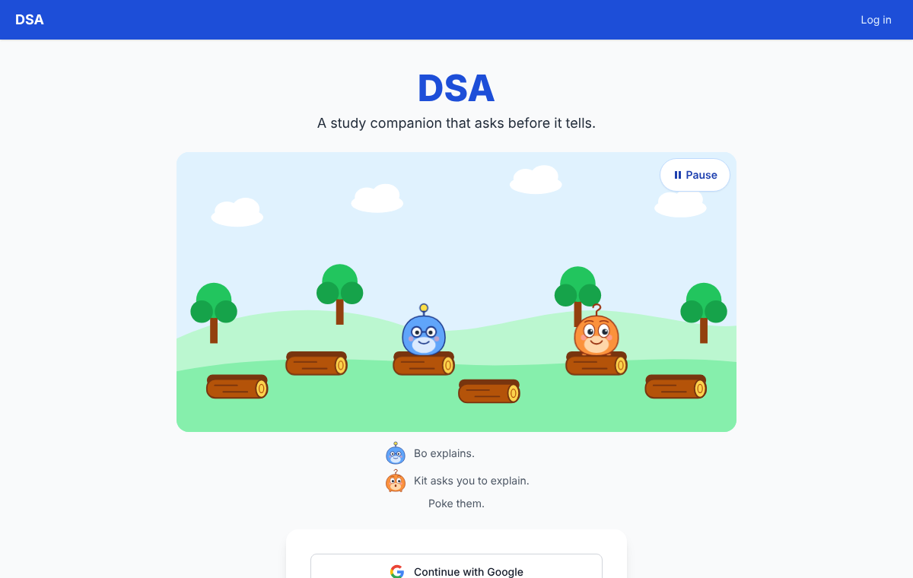
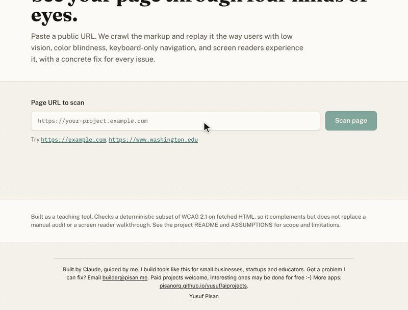
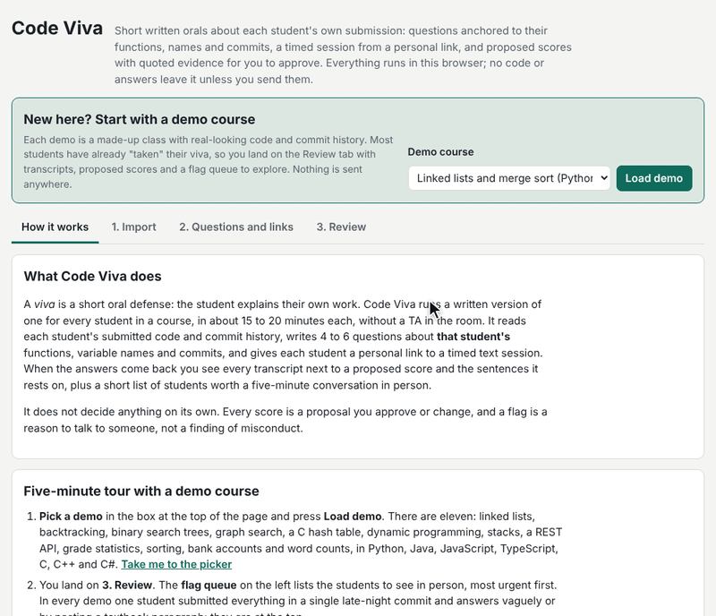
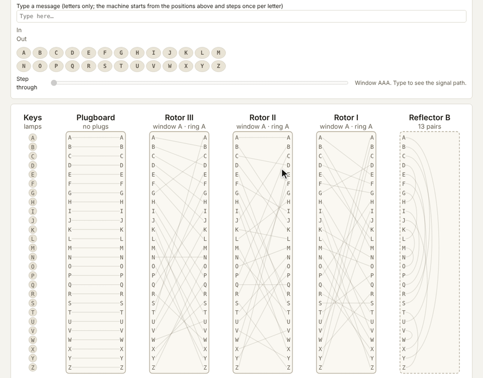
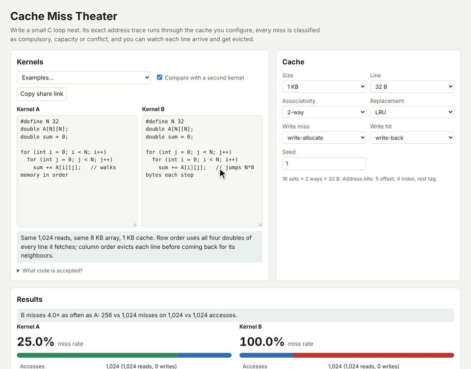
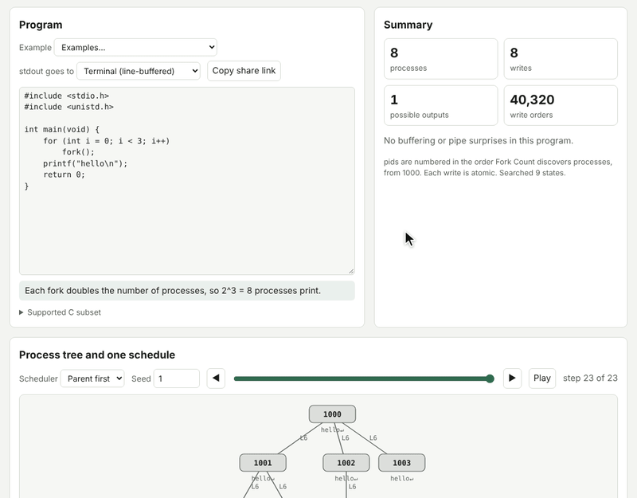
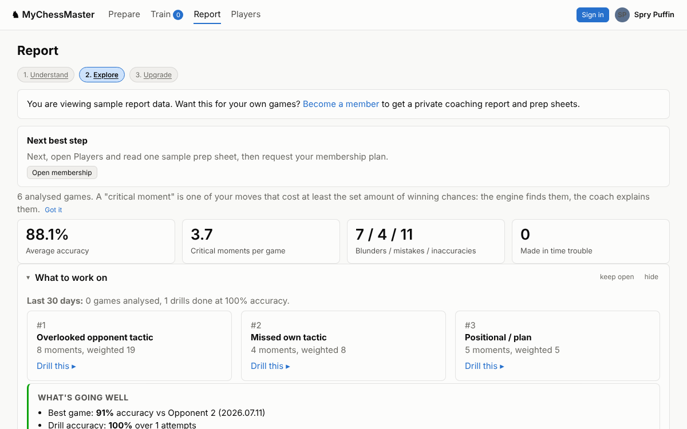

# 51 apps built by Claude

Free tools for small businesses, teachers, students and the curious. Every
one is live: click a name below and it opens in your browser. Most need no
sign-up and send nothing anywhere; your files stay on your computer.

Each app started as a one-paragraph idea. [Claude Code](https://claude.com/claude-code)
wrote the code; I picked the ideas, set the bar, reviewed the results and
said no a lot. Claude can write code. Getting it to build the right thing,
check it properly and ship something people can use still takes someone who
knows what good looks like. That part is my job.

**Want one built?** I build tools like these for small businesses, startups
and educators. Email [builder@pisan.me](mailto:builder@pisan.me?subject=Project%20idea)
with a paragraph about the problem and I'll tell you honestly whether it fits.
Paid work keeps the lights on, but a useful or interesting problem matters
more to me than the budget. Looking for ideas? I keep a public list of
[600+ things I could build for you](https://daily-project-ideas.pisan.me/).

Yusuf Pisan

## My biggest project

**[Digital Student Assistant](https://digital-student-assistant.com/)** is the
AI teaching assistant for my data structures courses at UW Bothell, and my
students are using it now. It guides rather than answers: it asks before it
tells, it will not hand over homework solutions, and it teaches from my own
lectures and recordings rather than the internet. How it holds back the answer
is written up in
[Teaching an LLM Tutor to Withhold the Answer](https://arxiv.org/abs/2608.12292).
Its code is private, and signing in needs a class account.

## Start here

<table>
<tr>
<td width="50%" valign="top">

<b><a href="https://accessibility-lens.pisan.me/">Accessibility Lens</a></b>: paste your website's address and see what blind, low-vision, color-blind and keyboard-only visitors get, with a suggested fix for each problem. For small businesses that want to know where their site stands before a customer tells them. <a href="./accessibility-lens">Code</a>

</td>
<td width="50%" valign="top">

<b><a href="https://code-viva.pisan.me/">Code Viva</a></b>: short written orals on each student's own code: questions anchored to their functions and commits, with a flag queue so TA time goes to the few who need a conversation. <a href="./code-viva">Code</a>

</td>
</tr>
<tr>
<td width="50%" valign="top">

<b><a href="https://bombe-bench.pisan.me/">Bombe Bench</a></b>: an Enigma you can open up, and a working Turing-Welchman Bombe that breaks messages from a crib. <a href="./bombe-bench">Code</a>

</td>
<td width="50%" valign="top">

<b><a href="https://cache-miss-theater.pisan.me/">Cache Miss Theater</a></b>: write a C loop nest and watch every access go through a cache you configure, with each miss labelled compulsory, capacity or conflict. <a href="./cache-miss-theater">Code</a>

</td>
</tr>
<tr>
<td width="50%" valign="top">

<b><a href="https://fork-count.pisan.me/">Fork Count</a></b>: paste a fork/wait/pipe snippet and see every process, every output the scheduler could produce, and why the others are impossible. <a href="./fork-count">Code</a>

</td>
<td width="50%" valign="top">

<b><a href="https://mychessmaster.net/">MyChessMaster</a></b>: a chess coach for tournament players: Stockfish finds where each game went wrong, a coach model explains why, and the mistakes become prep sheets and spaced-repetition drills. Built with Claude Code for tournament players preparing for a specific opponent; its code is in a private repo.

</td>
</tr>
</table>

## The catalog

### Tools for small businesses

| App | What it does |
|---|---|
| [Consent Leak Watch](https://consent-leak-watch.pisan.me/) ([code](./consent-leak-watch)) | Check that your shop's cookie banner really blocks trackers, and which plugin broke it. |

### Developer and web tools

| App | What it does |
|---|---|
| [Accessibility Lens](https://accessibility-lens.pisan.me/) ([code](./accessibility-lens)) | Scan a public page against WCAG 2.1, then see it the way low-vision, color-blind, keyboard-only and screen-reader users do. |
| [ACR Draft](https://acr-draft.pisan.me/) ([code](./acr-draft)) | Write the accessibility report (VPAT) a university asks for before it buys your software: scans plus a guided review, exported to Word. |
| [Agent Blast Radius](https://agent-blast-radius.pisan.me/) ([code](./agent-blast-radius)) | Drop in MCP configs and agent settings to see what each AI tool on your machine can reach. |
| [HAR Detective](https://har-detective.pisan.me/) ([code](./har-detective)) | Drag in a browser HAR file for a waterfall and a ranked, plain-English performance report. |
| [Cron Cartographer](https://cron-cartographer.pisan.me/) ([code](./cron-cartographer)) | Any cron expression, RRULE or GitHub Actions schedule as a calendar heatmap of when it fires. |
| [Schema Storyteller](https://schema-storyteller.pisan.me/) ([code](./schema-storyteller)) | Paste a SQL, Prisma or JSON schema, get the data model in plain English plus missing keys and indexes. |
| [Migration Diff Narrator](https://migration-diff-narrator.pisan.me/) ([code](./migration-diff-narrator)) | Two versions of a schema in, every change marked safe, caution or breaking out. |
| [Repo Weight Map](https://repo-weight-map.pisan.me/) ([code](./repo-weight-map)) | Drop a project folder in and see what is bloating it, with the `.gitignore` lines to fix it. |
| [UI Diff Lens](https://ui-diff-lens.pisan.me/) ([code](./ui-diff-lens)) | Two screenshots in, every changed region classified as layout, spacing, color, text and so on. |
| [Type Witness](https://type-witness.pisan.me/) ([code](./type-witness)) | Watch the TypeScript compiler infer types, expression by expression. |
| [Net Units](https://net-units.pisan.me/) ([code](./net-units)) | Measure how much code a change adds in syntax-level units instead of lines. |
| [Prompt Genome](https://prompt-genome.pisan.me/) ([code](./prompt-genome)) | Split a prompt into color-coded parts (role, task, constraint, format...) and lint it. |
| [Prompt Shrink Ray](https://prompt-shrink-ray.pisan.me/) ([code](./prompt-shrink-ray)) | Compress an LLM prompt with a live token estimate and a check that the keywords survived. |
| [Game Palette Inspector](https://game-palette-inspector.pisan.me/) ([code](./game-palette-inspector)) | Check a palette against WCAG contrast and 8 kinds of color blindness, with replacements that keep the art style. |
| [Diagram Layout Engine](https://diagram-layout-engine.pisan.me/) ([code](./diagram-layout-engine)) | A from-scratch layout engine for Mermaid flowcharts, with every stage of the pipeline visible. |
| [Modulo Bias Microscope](https://modulo-bias-microscope.pisan.me/) ([code](./modulo-bias-microscope)) | Paste a random sampling function and see exactly how biased it is. |
| [Shortcut Sprint](https://shortcut-sprint.pisan.me/) ([code](./shortcut-sprint)) | Spaced-repetition drills for keyboard shortcuts in VS Code, Vim, Figma, Excel and more. |

### Tools for teachers

| App | What it does |
|---|---|
| [Letter Ledger](https://letter-ledger.pisan.me/) ([code](./letter-ledger)) | Recommendation-letter requests: a request link with your policy and FERPA release, encrypted packets, a deadline dashboard. |
| [Code Viva](https://code-viva.pisan.me/) ([code](./code-viva)) | Short oral checks on each student's own submission, with questions anchored to their functions. |
| [Study Buddy Matchmaker](https://study-buddy-matchmaker.pisan.me/) ([code](./study-buddy-matchmaker)) | Upload a gradebook CSV and get complementary study pairs with shared agendas. |
| [Where Does It Say](https://where-does-it-say.pisan.me/) ([code](./where-does-it-say)) | Questions about the syllabus answered only with verbatim quotes, or a refusal. |
| [Code Analogy Forge](https://code-analogy-forge.pisan.me/) ([code](./code-analogy-forge)) | Three analogies for a piece of code or a CS concept, pitched at the audience you choose. |

### Interactive CS lessons

| App | What it does |
|---|---|
| [Bombe Bench](https://bombe-bench.pisan.me/) ([code](./bombe-bench)) | Step through an Enigma rotor by rotor, then break it with a working Bombe. |
| [Cache Miss Theater](https://cache-miss-theater.pisan.me/) ([code](./cache-miss-theater)) | Watch a C loop nest's exact address trace run through a configurable cache. |
| [Fork Count](https://fork-count.pisan.me/) ([code](./fork-count)) | Every process, pipe and possible output of a fork/wait/pipe C snippet, deadlocks included. |
| [Assignment Stress Test](https://assignment-stress-test.pisan.me/) ([code](./assignment-stress-test)) | Every output the scheduler could produce for a fork/wait snippet, and why the others are impossible. |
| [Heap Arena Replay](https://heap-arena-replay.pisan.me/) ([code](./heap-arena-replay)) | Replay a malloc/free trace on a word-accurate heap under different allocator policies. |
| [SQL Replay](https://sql-replay.pisan.me/) ([code](./sql-replay)) | Watch a SELECT execute step by step, each stage narrated. |
| [Edit Graph Lab](https://edit-graph-lab.pisan.me/) ([code](./edit-graph-lab)) | Diff as a shortest-path search, with Myers' algorithm animated. |
| [Data Structure City](https://data-structure-city.pisan.me/) ([code](./data-structure-city)) | A hash map, B-tree, skip list and LRU cache side by side, driven by one Redis-like console. |
| [GPU Parallel Puzzler](https://gpu-parallel-puzzler.pisan.me/) ([code](./gpu-parallel-puzzler)) | Twelve kernel puzzles on a simulated GPU: warps, divergence, coalescing, bank conflicts. |
| [Pathfinding Playground](https://pathfinding-playground.pisan.me/) ([code](./pathfinding-playground)) | Draw a grid and race BFS, Dijkstra, A* and friends across it. |
| [State Space Atlas](https://state-space-atlas.pisan.me/) ([code](./state-space-atlas)) | Every reachable state of Hanoi, sliding tiles, Klotski and Rush Hour, drawn as one graph. |
| [Elevator Algorithm Lab](https://elevator-algorithm-lab.pisan.me/) ([code](./elevator-algorithm-lab)) | Write an elevator dispatch policy in JavaScript and run it against seeded traffic. |
| [Lockstep Lab](https://lockstep-lab.pisan.me/) ([code](./lockstep-lab)) | Watch deterministic lockstep and rollback netcode work, and fail. |
| [Pull the Pin](https://pull-the-pin.pisan.me/) ([code](./pull-the-pin)) | An 8-bit SAP-1 computer where the instructor breaks a chip and students find the fault. |
| [Program Alarm 1202](https://program-alarm-1202.pisan.me/) ([code](./program-alarm-1202)) | A playable model of the Apollo Guidance Computer's executive during the lunar descent. |
| [Leap Second Lab](https://leap-second-lab.pisan.me/) ([code](./leap-second-lab)) | TAI, UTC, GPS, Unix and UT1 on one timeline, and what 23:59:60 does to your code. |
| [Cipher Ladder](https://cipher-ladder.pisan.me/) ([code](./cipher-ladder)) | Climb from Caesar to Vigenère to homophonic ciphers with live cryptanalysis tools. |
| [Code Review Gauntlet](https://code-review-gauntlet.pisan.me/) ([code](./code-review-gauntlet)) | Race the clock to spot planted bugs and security holes. |
| [Pluck Lab](https://pluck-lab.pisan.me/) ([code](./pluck-lab)) | A keyboard guitar synthesized live by Karplus-Strong, with the filter on screen. |
| [Tiny Brains League](https://tiny-brains-league.pisan.me/) ([code](./tiny-brains-league)) | Train the smallest Connect Four network you can and climb a ladder. |
| [Brocot Gear Finder](https://brocot-gear-finder.pisan.me/) ([code](./brocot-gear-finder)) | Gear trains for any ratio with continued fractions and the Stern-Brocot tree. |

### Games and toys

| App | What it does |
|---|---|
| [Poincaré Paint](https://poincare-paint.pisan.me/) ([code](./poincare-paint)) | Draw in the hyperbolic disk and watch every stroke tile to infinity. |
| [Tamerlane Board](https://tamerlane-board.pisan.me/) ([code](./tamerlane-board)) | Timur's 14th-century chess with giraffes, war engines and citadels. |
| [Reverse Minesweeper Studio](https://reverse-minesweeper-studio.pisan.me/) ([code](./reverse-minesweeper-studio)) | Paint a picture with mines and find out if it can be solved without guessing. |
| [Outguess Me](https://outguess-me.pisan.me/) ([code](./outguess-me)) | Press F or J as randomly as you can while an oracle predicts you. You are less random than you think. |
| [Sound Sketchpad](https://sound-sketchpad.pisan.me/) ([code](./sound-sketchpad)) | Describe a sound effect in words and get playable audio with WAV export. |
| [Emoji Lingua](https://emoji-lingua.pisan.me/) ([code](./emoji-lingua)) | English to emoji and back. |
| [Mult Streak](https://mult-streak.pisan.me/) ([code](./mult-streak)) | Ten multiplications in a row wins a 24-hour crown. |

For the technical side of each app (how it works, design decisions and what
it deliberately leaves out), see [PROJECTS.md](./PROJECTS.md). Each app also has its own
repository in [pisan-labs](https://github.com/pisan-labs), if you want to star,
fork or reuse just one.

## Working with me

Tell me the problem, not the solution: who is stuck, what they do today and
what it costs them. I'll say whether software is the right answer, and if it
is, what a first version would do and what it would leave out. Every app
here was built the same way: a small, working first version that real people
can try, then improvements from what they say.

## Free to use and reuse

Every app is free to use, and the code is [MIT licensed](./LICENSE), so you
can copy it, change it and use it in your own work. Developers: how the
repository is organized, tested and deployed is in
[DEVELOPING.md](./DEVELOPING.md).
