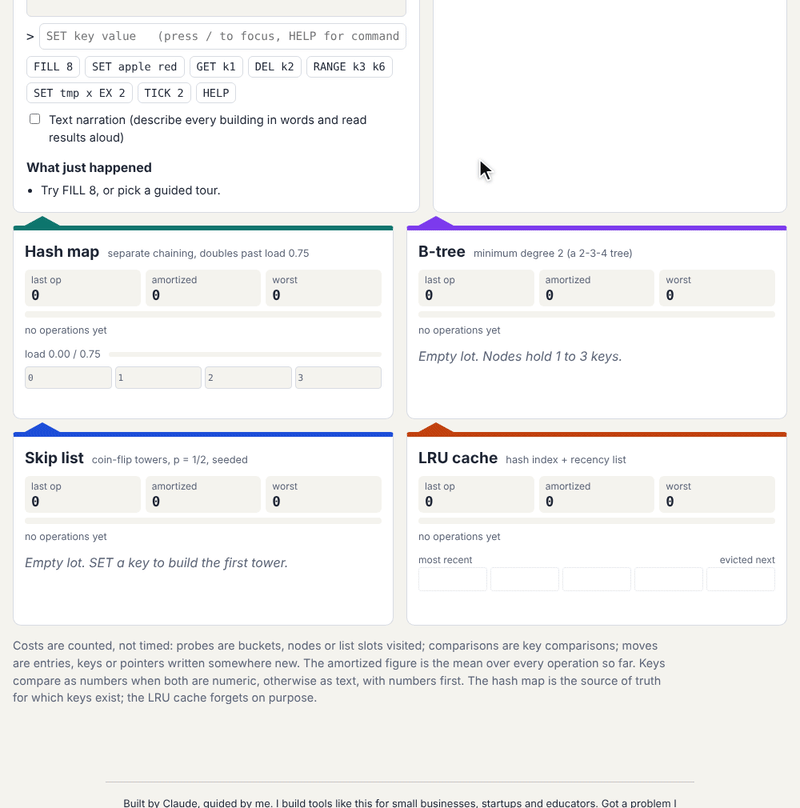

# Data Structure City

Four buildings and one console. Every command you type runs against a **hash
map**, a **B-tree**, a **skip list** and an **LRU cache** at the same time, so
you can watch each one change shape and compare what the same operation cost
in each.

Live: <https://data-structure-city.pisan.me>



Built from the idea "Data Structure City" (2026-09-26, #2) in
[`pisanuw/daily-project-ideas`](https://github.com/pisanuw/daily-project-ideas).

## What you can do

- **Type Redis-like commands**: `SET key value [EX ticks]`, `GET`, `DEL`,
  `EXPIRE`, `TTL`, `TICK`, `RANGE lo hi`, `FILL n [prefix]`, `CAPACITY n`,
  `SEED n`, `KEYS`, `RESET`, `HELP`. Up arrow recalls history; `/` focuses the
  console from anywhere.
- **Watch the internals**:
  - *Hash map*: separate chaining, 4 buckets to start, doubles when the load
    factor would pass 0.75. Collided buckets are outlined; a rehash moves every
    entry, and the meter shows the spike.
  - *B-tree*: minimum degree 2 (a 2-3-4 tree), CLRS-style: full nodes split on
    the way down, and deletes borrow from or merge with a sibling on the way
    down. Splits, merges, borrows, growth and shrinkage are reported.
  - *Skip list*: p = 1/2 towers from a seeded PRNG, so the same commands and
    seed build the same city for every student. `SEED n` picks another.
  - *LRU cache*: hash index plus a recency list, 5 slots by default. Hits move
    to the front; a full cache evicts the tail. It forgets on purpose, so
    `GET` can miss in the cache while the other three buildings hit.
- **Read the cost meters**: each building shows the last operation's cost, the
  running mean (the amortized cost) and the worst single operation, split into
  probes (buckets, nodes, slots visited), comparisons and moves (entries, keys
  or pointers written somewhere new). `FILL 16` makes amortized vs worst-case
  concrete: the hash map's worst SET is several times its mean.
- **Range queries**: `RANGE` is cheap in the ordered buildings and a full scan
  in the hash map and the cache, and the meters show it.
- **Time to live**: `EX` and `EXPIRE` set a TTL in logical ticks; `TICK`
  advances the clock and sweeps expired keys from every building.
- **Guided tours**: five built-in tours (rehash, B-tree splits and merges, LRU
  eviction, skip-list towers and range queries, TTL). Each stop asks you to
  predict what will happen before the commands run, then reveals the answer.
  Instructors can edit the tour JSON in the page and make a share link; the
  whole tour lives in the URL fragment, so nothing is uploaded or stored.
- **Accessibility**: everything is reachable by keyboard (arrow keys move
  between buildings), changes are announced through a polite live region, and
  *Text narration* mode describes every building in words (bucket contents,
  tree shape, tower levels, recency order) and reads every per-building result.
  Highlights respect `prefers-reduced-motion`.

## Tour format

```json
{
  "title": "My tour",
  "seed": 7,
  "stops": [
    {
      "say": "Shown before the commands run.",
      "run": ["SET a 1", "SET b 2"],
      "question": {
        "prompt": "What happens next?",
        "choices": ["This", "That"],
        "answer": 1,
        "explain": "Shown after the commands run."
      }
    }
  ]
}
```

`seed` and `question` are optional. Tours are validated before they run (at
most 40 stops, 40 commands per stop, 2 to 6 choices).

## Design notes

- No backend and no LLM. The idea suggested Supabase for saved tours; a URL
  fragment does the same job for sharing with no accounts and no storage.
- Keys order naturally: two numbers compare numerically, numbers come before
  words, and digit runs inside words compare as numbers (`k2 < k10`).
- The hash map is the source of truth for which keys exist. The city holds at
  most 40 keys so every building stays readable.
- Costs are counted operations, not timings. The counting rules are in each
  structure's source (`src/core/*.ts`), and the narration states the breakdown
  for every operation.

## Limitations

- Changes are shown as highlights and event notes, not tweened animation:
  you see the before and after of a split or rehash, not the keys sliding.
- The hash map never shrinks, the B-tree degree and initial bucket count are
  fixed in the UI, and keys are capped at 16 characters (labels are truncated
  to 6 in the drawings; hover or narration shows the full key).
- There is no 3D view.

## Development

```bash
npm install
npm run dev        # http://localhost:5173
npm run lint
npm run typecheck
npm run coverage   # vitest, >= 85% thresholds on src/core
npm run build
```

`src/core` holds the data structures, parser, city, narration and tours, all
DOM-free and unit-tested (71 tests, including a 600-step randomized B-tree
check that validates every invariant after each insert or delete, and a test
that each built-in tour's answers match what the city actually does).
`src/ui` is the DOM glue, checked in a real browser.
