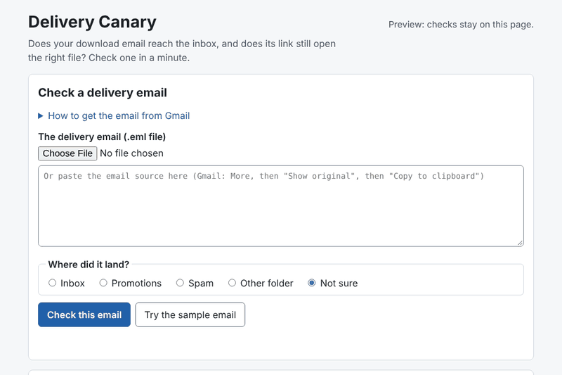

# Delivery Canary

**Live: https://delivery-canary.hintwise.org**

For shops that sell digital files on Shopify (patterns, ebooks, presets,
templates, printables). Delivery Canary places a free test order in your shop
on a schedule, watches a test Gmail inbox for the download email, and emails
you when that email lands in Spam, never arrives, or its link stops giving the
right file. You hear about it before a customer writes to say nothing came.

## What it does

1. **Check a delivery email.** Drop in a download email (in Gmail: More, then
   "Download message") or paste its source. You get, in plain words, where it
   landed (Inbox, Promotions or Spam), whether it passed the sender checks
   Gmail uses (SPF, DKIM, DMARC) and is signed with your own domain, how long
   it took to arrive, which delivery app sent it, and whether the download link
   works and gives the same file as your saved baseline. Each problem comes
   with what to change.
2. **Check your seed inbox.** Keep a Gmail account just for test orders. Give
   Delivery Canary an app password for it and "Check my seed inbox now" finds
   your newest download email there, reads where Gmail put it, and checks it
   like step 1.
3. **Canary orders from Shopify.** Connect your shop with a small app you
   create in Shopify's Dev Dashboard (about 5 minutes; the steps are on the
   page). Pick a download product, and Delivery Canary places a free test
   order for it, addressed to your seed inbox, then watches for the email:
   how long it took, where Gmail put it, and whether the link still opens the
   right file.
4. **Scheduled canaries and alerts.** Turn on a weekly or daily canary at the
   hour you choose. It runs on its own, with nobody keeping the page open.
   You get an email when the download email lands in Spam, fails its check,
   never arrives within 40 minutes, or when Shopify refuses the order. A
   weekly digest is optional, and every email has a one-click unsubscribe.
   The page shows where your canaries landed over the last 8 weeks.
5. **Late download orders.** Drop Shopify's orders export (Orders, Export,
   CSV), or read the last 30 days straight from your connected shop. Paid
   orders whose download items are still unfulfilled after a grace period
   (1 hour by default) are listed with what to do, and you can download the
   list. Each scan is compared with your last one.

Every card has a sample you can try without an account.

## What you need

- A Shopify shop that sells digital downloads through Shopify Digital
  Products or another delivery app that emails a download link.
- For steps 2 to 4: a Gmail account kept for test orders, with 2-Step
  Verification on and an app password. Use a new account, not your personal
  or shop mailbox.
- For steps 3 and 4: a download product that costs nothing to give away,
  needs no shipping, and is small (each canary downloads the file once).
- An account here: sign in with Google or an email link.

## What is stored, and what is not

- **Your emails are read in your browser.** A dropped or pasted email is never
  uploaded. The seed inbox check reads the email on our server and passes it
  straight to your page; nothing of the email is kept.
- **Saved in your account** (Supabase, US East): your shop's name and
  delivery app, the size and fingerprint of your baseline file, each check's
  result (only the website name of the download link, never the full link),
  late order scans (order number, times and product names only), your seed
  address and sender, your Shopify app's client ID, your schedule, and each
  canary's outcome.
- **Never read from your orders:** customer names, emails, phone numbers,
  addresses, notes or tags. The export is read in your browser with a fixed
  list of columns, and the shop connection never asks Shopify for customer
  fields.
- **Kept only sealed:** the seed inbox app password (if you tick "Keep") and
  your Shopify app's client secret are encrypted before they are saved and
  are never sent back to your browser. Your shop's app can only read orders
  and products and create draft orders; Delivery Canary refuses an app with
  more access than that. Canary orders only ever go to the seed address you
  had when you connected the shop.
- **Link tests:** to test a download link on another site, the link goes to
  our server, which downloads the file once and returns its size and
  fingerprint. The file itself is not kept.
- The page loads one font, for the "Continue with Google" button, from
  Google Fonts.
- To delete everything: "Delete my account" under Sign out. To stop a
  shop's canaries: turn the schedule off, or disconnect the shop.

## Limits

- Placement is measured in one Gmail inbox. Outlook, Yahoo and other
  mailboxes can file the same email differently.
- Some delivery apps may not send their email for an order made from a draft
  order. If no email arrives for a canary, Delivery Canary says so; place a
  real 100%-off order once to tell the two apart.
- Each canary uses one of your file's downloads and some of your shop's
  bandwidth. Weekly is the default for that reason, and there are at most 5
  canaries a day per account.
- If your delivery app never marks orders fulfilled, every download order
  looks late in the orders scan; the scan warns you when it sees this.

## Questions

Write to support@hintwise.org.

---

For developers: `npm ci && npm run lint && npm run typecheck && npm run
coverage && npm run build`; `npm run e2e` for the Playwright walkthrough
(`vite preview` with in-memory storage). Architecture, decisions and build
state are in `HANDOFF.md` and `docs/PLAN.md`.
