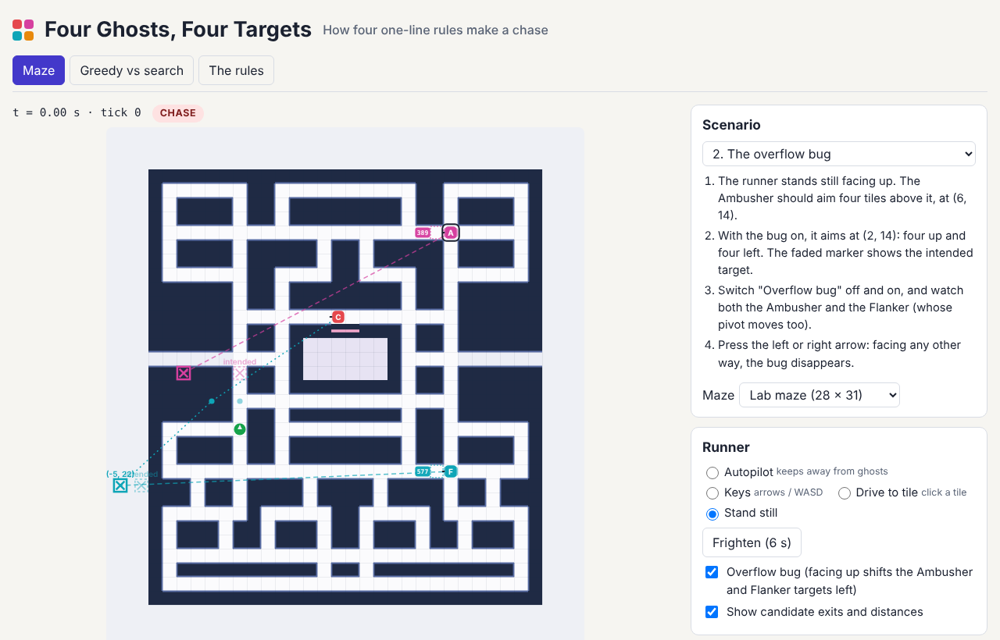

# Four Ghosts, Four Targets

A maze-chase AI lab for game-AI and intro AI lectures. Four chasers move by
the one-line rule documented for the 1980 arcade ghosts: at every tile, take
the exit closest in a straight line to a target tile, never turn back, and
break ties up > left > down > right. Each ghost picks its target differently,
and the app draws every target, every candidate exit and every distance it
compared, so students can watch the AI think one tick at a time.

Live: [four-ghosts.hintwise.org](https://four-ghosts.hintwise.org)

Built from idea 2026-10-09 n1 in
[`pisanuw/daily-project-ideas`](https://github.com/pisanuw/daily-project-ideas).
The maze, names, colours and graphics are original; this is a teaching lab
for the targeting rules, not a recreation of the arcade game (no dots, fruit,
lives or score). Everything runs in the browser; there is no backend.



## The four ghosts

| Ghost | Chase target | Modelled on |
|---|---|---|
| Chaser | the runner's tile | Blinky |
| Ambusher | 4 tiles ahead of the runner (4 up **and 4 left** when it faces up, with the overflow bug on) | Pinky |
| Flanker | the point 2 ahead of the runner, then the vector from the Chaser to it doubled (bug applies to the pivot) | Inky |
| Shy | the runner while 8 or more tiles away, otherwise its scatter corner | Clyde |

In scatter mode each heads for a corner outside the maze. The level 1
schedule (scatter 7 s, chase 20 s, 7, 20, 5, 20, 5, then chase forever) runs
on a clock that stops during fright, and every scatter/chase switch makes
every ghost reverse at its next tile.

## The three tabs

**Maze.** A 28 × 31 lab maze with a ghost house and a slow tunnel, and a
15 × 11 tracing maze small enough to work by hand. The runner can be on
autopilot, steered from the keyboard or an on-screen pad, driven to a clicked
tile, or parked (Shift-click puts it on a tile). Play at 0.1× to 2×, step one
tick forward or back (30 s of history), or run to the next real decision.
Overlays show each ghost's target tile, the Flanker's Chaser → pivot →
target construction, Shy's eight-tile circle, the bug-free target when the
overflow bug moved it, and the distances on the exits of the next decision.
The Ghost cam lists the next and the last decision of one ghost as a table
(exit, tile, squared distance, verdict, including ties lost on order). Any
ghost can be switched to BFS or A* pursuit, and then the Ghost cam shows how
many tiles each search expanded for the same decision. A Frighten button
starts the 6 s fright.

Lesson scenarios set up a situation and say what to look for:

1. One decision, by hand: a tie at squared distance 41 that up wins.
2. The overflow bug: the Ambusher aims at (2, 14) instead of (6, 14).
3. The Flanker's vector.
4. Shy never closes in on a runner parked in the top-right corner.
5. Everyone turns around at 7.0 s.
6. Greedy vs shortest path: a BFS ghost reaches a parked runner at (6, 1) in
   about two seconds, while the greedy Chaser circles a block forever.

**Greedy vs search.** Runs seeded games (6 to 48 per lineup, 60 to 240 s)
against the autopilot runner in a Web Worker and compares four target-tile
ghosts, four BFS ghosts, four A* ghosts and a custom mix: captures per
minute, median time to the first capture, games never caught, the share of
chase time in which two ghosts were within three tiles, and mean spread. On
the lab maze (12 games of 120 s) the shortest-path ghosts catch about twice
as often but are bunched 87% of chase time against 67%, with a mean spacing
of about 5 tiles against 8. On the small tracing maze the pack catches
*less* often than the target-tile ghosts, because ghosts in single file block
each other's routes. So optimal pursuit is not simply better: it collapses
four ghosts into one, while four different targets keep them spread out and
coming from different sides, which is what makes the chase readable.

**The rules.** The decision rule as pseudo-code, the four targets, the
overflow bug, modes, speeds and what this lab simplifies.

## Model and simplifications

60 ticks a second; level 1 speeds (runner 80%, 90% in fright; ghosts 75%,
40% in the tunnel, 50% frightened) of 75.76 px/s on 8 px tiles. Ghosts
decide on arriving at a tile (the arcade decides one tile ahead), leave the
house on a 1/4/8 s timer instead of dot counters, and return to the exit by
a shortest path when eaten (the greedy rule can circle a block of this maze
forever). There are no "no upward turn" zones or cornering speed-ups.
Capture is a same-tile check, so a ghost and the runner can occasionally
pass through each other. Frightened ghosts use a seeded PRNG, not the
arcade's.

The autopilot runner counts, for each exit, the tiles it can reach before
any ghost (allowing for its speed advantage) and takes the exit with the most
room; with plenty of room everywhere it wanders toward a random tile. It is a
fixed opponent for comparing lineups, not a strong player.

Sources: Chad Birch, "Understanding Pac-Man Ghost Behavior" (gameinternals.com),
and Jamey Pittman, "The Pac-Man Dossier".

## Limitations

- One autopilot opponent: lineup results depend on it, and a human plays
  differently. The comparison is a demonstration, not a benchmark.
- Only level 1 timings. Later levels' schedules, speeds and shorter fright
  are not modelled, nor is the Chaser's speed-up as dots run out.
- The app is the lab, not the game; you cannot win.

## Development

```bash
npm install
npm run dev        # Vite dev server
npm run lint
npm run typecheck
npm run coverage   # vitest, ≥85% thresholds on src/core
npm run build
```

The core (`src/core/`: mazes, targeting rules, decisions, search, modes,
simulation, experiments and scenarios) has 55 vitest tests and 99.6%
statement coverage. Tests pin the scenario claims (the tie at 41, the bug
target, Shy never catching a parked runner, the forced reversals, BFS beating
the greedy loop) and check that BFS and A* return equally short valid paths.
The DOM glue (`src/ui/`) was checked in Chromium at 1280 px and 390 px.
