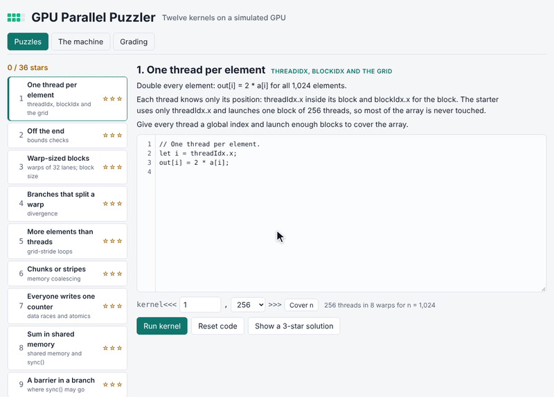
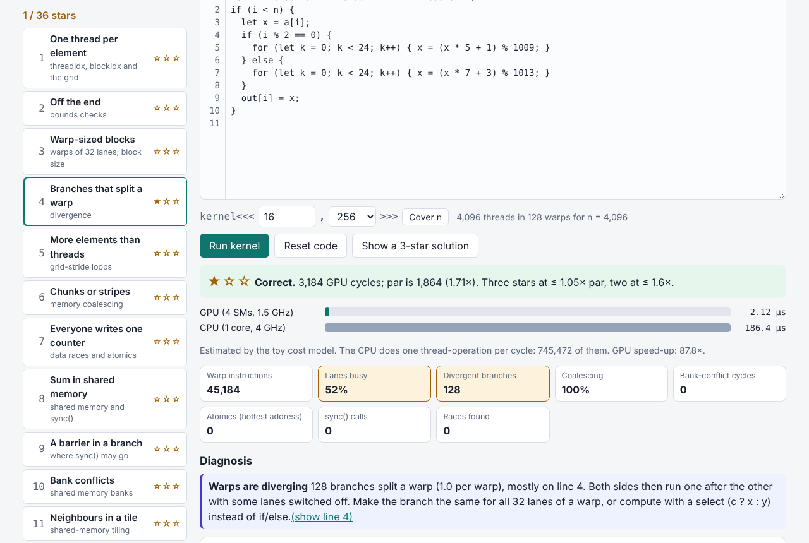

# GPU Parallel Puzzler

Twelve parallel-programming puzzles on a simulated GPU. Students write small
CUDA-style kernels, choose the launch (`kernel<<<grid, block>>>`), and see
what the hardware would do with them: warps of 32 lanes, divergent branches,
coalesced and uncoalesced memory, shared-memory bank conflicts, barriers,
atomics and data races. Every run is graded for correctness and against a
par time, with a CPU-vs-GPU estimate and plain-language hints.

Live: [gpu-parallel-puzzler.hintwise.org](https://gpu-parallel-puzzler.hintwise.org)



Built from idea 2026-06-23 n2 in
[`pisanuw/daily-project-ideas`](https://github.com/pisanuw/daily-project-ideas).
The idea's Claude hint system is replaced by a deterministic diagnosis that
reads the simulator's counters and traces, and its Supabase dashboard by
JSON exports that an instructor loads into a class table. WebGPU is not
used: the GPU is simulated in TypeScript, so every browser gives the same
numbers. Everything runs client-side.



## The levels

| # | Level | Concept | The starter's problem |
|---|---|---|---|
| 1 | One thread per element | threadIdx, blockIdx, grid | only one block's worth of output |
| 2 | Off the end | bounds checks | crashes past the end of the array |
| 3 | Warp-sized blocks | warps; block size | blocks of 48 waste lanes and pay start-up costs |
| 4 | Branches that split a warp | divergence | `if (i % 2 == 0)` runs both paths in every warp |
| 5 | More elements than threads | grid-stride loops | 2,048 threads for 20,000 elements |
| 6 | Chunks or stripes | coalescing | CPU-style chunks: 8× the memory segments |
| 7 | Everyone writes one counter | races and atomics | `out[0] += 1` loses updates |
| 8 | Sum in shared memory | shared memory, sync() | one atomic per element on one address |
| 9 | A barrier in a branch | where sync() may go | `sync()` inside `if (t < st)` |
| 10 | Bank conflicts | shared memory banks | interleaved tree, up to 16-way conflicts |
| 11 | Neighbours in a tile | shared-memory tiling | each element fetched nine times |
| 12 | Sixteen bins | privatization | 16,384 atomics on 16 addresses |

One star for correct, race-free output; two within 1.6× of par; three
within 1.05× of par. Par is the simulated time of a reference solution,
which a student can reveal (with a warning before they have solved it).

## What a run shows

- **Verdict** with stars, GPU cycles and the ratio to par.
- **GPU vs CPU** bars from the cost model, with the speed-up.
- **Counters**: warp instructions, share of lanes busy, divergent branches,
  coalescing efficiency, bank-conflict cycles, atomics and the hottest
  address, sync() calls, races found.
- **Diagnosis**: errors with the offending thread (for example `a[1000] is
  out of bounds` from thread 1000), part of the output never written,
  each race with the two threads and the fix, then performance hints ranked
  by impact, each pointing at a line.
- **Blocks on the SMs**: a Gantt chart of every block on the four SMs.
- **Warp inspector**: every instruction of a traced warp with its 32-lane
  mask. Memory rows colour each lane by its 128-byte segment (global) or
  bank (shared), so a coalesced access is one colour. Play steps through and
  highlights the line in the editor.

## The simulator

`src/core/lang.ts` parses a small C-like language (let, if/else, for, while,
return, `shared s[N];`, `sync();`, `c ? x : y`, min/max/abs/floor/sqrt,
`atomicAdd`). `src/core/gpu.ts` runs it a warp at a time with an active-lane
mask: an if whose condition differs across lanes runs both sides, a loop
runs while any lane continues, and a select evaluates both sides without
branching. Warps are generators that pause at `sync()`, and a barrier that
only some lanes reach is an error. Every memory access is checked for bounds
and races: in shared memory, two threads touching a word between barriers
with a write; in global memory also any write by two blocks.

The cost model is in `MACHINE`: 4 SMs with 4 warp schedulers each, 1 cycle
per warp instruction, 4 cycles per 128-byte global segment, 2 extra cycles
per queued address in a shared bank, serialized atomics plus a whole-GPU
limit of one atomic per address every 2 cycles, 24 cycles per block and 200
per launch. The CPU estimate is one thread-operation per cycle on a 4 GHz
core against a 1.5 GHz GPU. The machine page in the app documents all of it.

## Grading tab

Students enter a name and export their progress (stars, best cycles,
attempts, code and launch per level) as JSON. Instructors download a
Markdown rubric with par per level, load any number of exports, and get a
class table and CSV. Progress lives in `localStorage`, guarded, so the app
works when storage is blocked.

## Limitations

- **A teaching model, not a GPU.** No caches, latency hiding, occupancy,
  2D/3D indices or real clock behaviour. Cycle counts are for comparing a
  student's own versions, not for predicting hardware.
- Blocks run in a fixed order, so racy code gives the same wrong answer
  every time; the race detector stands in for real nondeterminism.
- Values are untyped numbers, so `/` truncates whenever both operands are
  whole, even `9.0 / 2`.
- No server: exports are files, and a determined student could edit one.
  The instructor can re-run any exported code in the level to check it.

## Development

```bash
npm install
npm run dev
npm run lint
npm run typecheck
npm run coverage   # vitest, ≥85% thresholds on src/core
npm run build
```

36 vitest tests with 99.2% statement coverage on `src/core`. For every level
the reference solution must earn three stars with no races and the starter
must show its intended problem (incomplete, crash, race or slow with a
performance hint). The DOM glue was checked in Chromium at 1280 px and
390 px.
