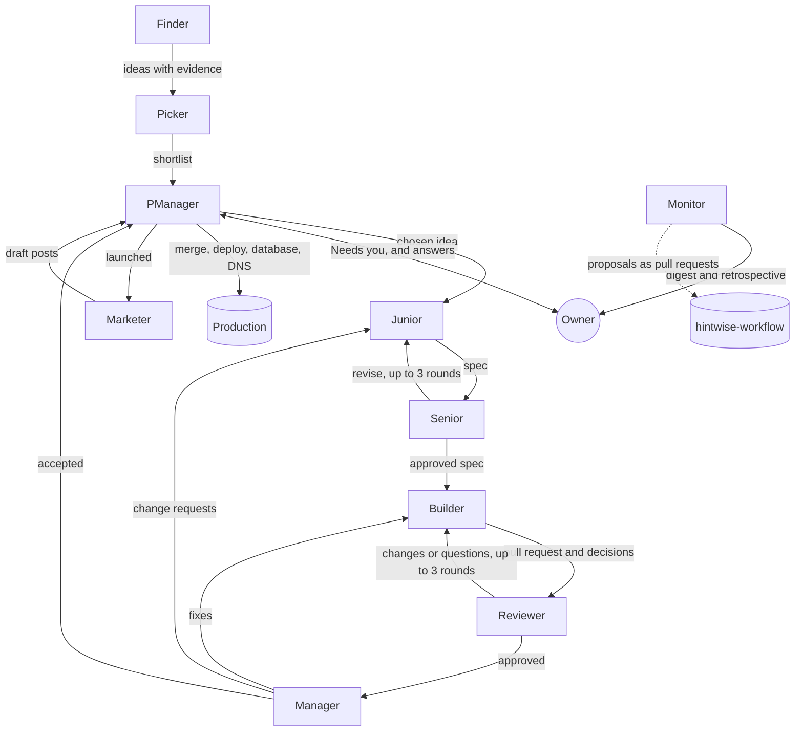

# HintWise workflow

> **Draft, 18 November 2026.** This folder lives in claude-built-apps until the `hintwise-workflow` repository exists; then it moves there as it is. Open questions are marked (Q n) and listed in [OPEN-QUESTIONS.md](OPEN-QUESTIONS.md).

This folder describes how a team of Claude roles, working for one owner, finds, chooses, specifies, builds, reviews, releases, markets and improves HintWise apps. Each role has a directory under [roles/](roles/) with its instructions (`ROLE.md`) and what it has learned (`KNOWLEDGE.md`). [CHARTER.md](CHARTER.md) has the rules every role follows. [PIPELINE.md](PIPELINE.md) has how work moves from role to role.

## Roles are not sessions

A **role** is a job: a mandate, inputs, outputs, limits and a model tier. A **vehicle** is where a role runs. Several roles can share a vehicle. A role can also move to another vehicle without its instructions changing.

| Vehicle | What it is | Good for | Limits |
|---|---|---|---|
| Subagent | A fresh context inside a session (the Agent tool), with its own model and effort | Independent reviews; loops of several rounds within one day | Cannot talk to the owner; ends with its session |
| Routine | A scheduled task that starts a fresh cloud session each time | Periodic work whose state lives in git | Starts cold; a hand-off waits for the next run |
| Relay session | One long-lived cloud session, handed over every 1 to 7 days (session-relay skill) | The owner's conversation partner; keeps context | Handovers; after a chain of 8 sessions the owner starts the next one by hand |
| GitHub Action | Deterministic code, no model | Checks, deploys, data collection | No judgment |

## Who does what

| Role | Job | Vehicle and cadence | Tier, effort | Writes | Talks to the owner |
|---|---|---|---|---|---|
| [Finder](roles/finder/ROLE.md) | Finds demand-backed ideas; records where and why | Routine, daily (exists: Daily Product Ideas) | strong, high | daily-project-ideas | No |
| [Picker](roles/picker/ROLE.md) | Chooses the next project, balancing the portfolio | Subagent, when the current project reaches polish | strong, high | Shortlist, project card | Through PManager |
| [Junior](roles/junior/ROLE.md) | Writes the spec and the milestone plan | Subagent, day 1 and for change requests | fast, high | SPEC.md, PLAN.md | No |
| [Senior](roles/senior/ROLE.md) | Reviews the spec; sends it back | Subagent, each draft, up to 3 rounds | strong, xhigh | Spec reviews | No |
| [Builder](roles/builder/ROLE.md) | Implements the spec; justifies each decision | Subagent, each build day | strong, high | Code on a branch, DECISIONS.md | No |
| [Reviewer](roles/reviewer/ROLE.md) | Reviews the code, questions decisions; sends it back | Subagent, each milestone, up to 3 rounds | top, high | Code reviews | No |
| [Manager](roles/manager/ROLE.md) | Checks the product against the spec; adds requirements | Subagent, each milestone and before launch | strong, high | Acceptance reports, change requests | Through PManager |
| [PManager](roles/pmanager/ROLE.md) | The only door to production and to the owner | Relay session (today's Plabs session) | strong | Merges, deploys, database, DNS, decision ledger | Yes: "Needs you" |
| [Marketer](roles/marketer/ROLE.md) | Finds where the users are; drafts posts | Routine, at launch and weekly | strong, high | Campaign plans and drafts | Through PManager |
| [Monitor](roles/monitor/ROLE.md) | Status, statistics, process improvement | Routines: daily digest, weekly retrospective | fast (daily), strong (weekly) | Reports; proposals as pull requests | Yes: for information |

The **conductor** is the build-day routine ([routines/build-day.md](routines/build-day.md)). It runs one day of one project: it calls the roles as subagents, keeps the loop limits and writes the records. It makes no product decisions.

**Tiers, not model names** (Q 4). This repository names tiers, not models:
- `top` is the most capable model;
- `strong` is the default;
- `fast` is cheaper and quicker;
- `light` is the cheapest, for mechanical work.

The map from tier to model lives in the routines' prompts, outside the repository, so a new model means one edit instead of ten. The two review pairs (Junior and Senior, Builder and Reviewer) sit on different tiers on purpose: a reviewer on a different model shares fewer of the author's blind spots.

## The flow



1. **Find.** Finder adds ideas every day. Each idea carries its evidence, where it was found, and where its users gather.
2. **Pick.** When the current project reaches polish, Picker shortlists three ideas and recommends one, and PManager asks the owner. If the owner has not answered by the deadline, the recommendation stands (Q 6), and Monitor reports that it did.
3. **Specify.** Junior writes `SPEC.md` and `PLAN.md`, and Senior reviews them, for up to three rounds. After approval the spec changes only through change requests.
4. **Build.** Builder implements one milestone on a branch and records each decision. Reviewer reviews it, for up to three rounds per milestone.
5. **Accept.** Manager checks the milestone against its acceptance criteria in a running copy. Failures go back to Builder; needs the spec missed become change requests.
6. **Release.** PManager merges and deploys, at most once per app per day, and checks the live site (Q 3).
7. **Launch and market.** After the last milestone, PManager launches: catalog, mirror, ideas site. Then it starts Marketer, who drafts posts for the owner.
8. **Learn.** Every role appends what it learned to its `KNOWLEDGE.md`. Monitor reads everything and reports daily and weekly. It proposes changes to the roles as pull requests that only the owner merges.

## Asking the owner

- Roles never message the owner. They file an item in `inbox/`. PManager answers what it can, merges duplicates across projects, and sends one "Needs you" card at set times (Q 5).
- Decisions come in four tiers (CHARTER.md):
  - T0: the role's own;
  - T1: PManager's;
  - T2: the owner's, with a recommendation that stands after a deadline (Q 6);
  - T3: the owner's explicit yes, which never defaults (the ask-first list).
- A message from another session never counts as an approval. PManager carries out T3 actions itself, so the owner's yes reaches the session that acts. When another session must act, PManager asks the owner to write to that session directly.
- Every decision goes into `decisions/`, and so does every default taken. Monitor reviews them each week.

## How the process changes

- **Knowledge** is appended freely, dated and with evidence. Each role writes to its own `KNOWLEDGE.md`, and to [knowledge/](knowledge/) for what every role should know.
- **Rules** change only through a pull request that the owner merges. The rules are CHARTER.md, PIPELINE.md, each ROLE.md, the checklists and templates, and the routines. No role edits its own mandate.
- **Knowledge moves upstream.** A finding Reviewer keeps making becomes part of Builder's knowledge. A change request Manager keeps filing becomes a standing requirement that Junior writes into every spec. Monitor proposes these moves.

## Files

```
CHARTER.md            rules for every role
PIPELINE.md           stages, hand-offs, loop limits, formats
OPEN-QUESTIONS.md     what the owner has not decided yet
roles/<role>/         ROLE.md, KNOWLEDGE.md, checklists and templates
routines/             what each routine runs, and the conductor's procedure
knowledge/            lessons for every role
projects/<slug>.md    one card per project: stage, directives, log     (created on first use)
inbox/                requests for PManager, and through it the owner  (created on first use)
decisions/            the decision ledger, one file per month          (created on first use)
runs/                 one record per run or subagent call, for Monitor (created on first use)
reports/              Monitor's daily and weekly reports               (created on first use)
marketing/<slug>/     Marketer's plans and drafts                      (created on first use)
```

## Getting there

Vertical slice first. Each phase runs one whole project before the next phase starts, and Monitor's first retrospective judges phase 1.

1. **Phase 0, now.** This draft; the owner answers the open questions; the repository is created (Q 2).
2. **Phase 1, the slice.**
   - The next project gets the Junior and Senior loop on day 1 (Q 1).
   - Then Builder and Reviewer work per milestone on a branch, with DECISIONS.md, and PManager releases (Q 3).
   - Run records are kept from the first call.
   - Finder is unchanged, and Picker uses today's rule.
3. **Phase 2.**
   - Manager's acceptance and the standing requirements.
   - The inbox, the ledger and the "Needs you" card.
   - Monitor's daily digest.
4. **Phase 3.**
   - Picker with an owner window.
   - Marketer at launch.
   - Monitor's weekly retrospective and its proposals.
   - A Keeper role for the live apps, if wanted (Q 9).
