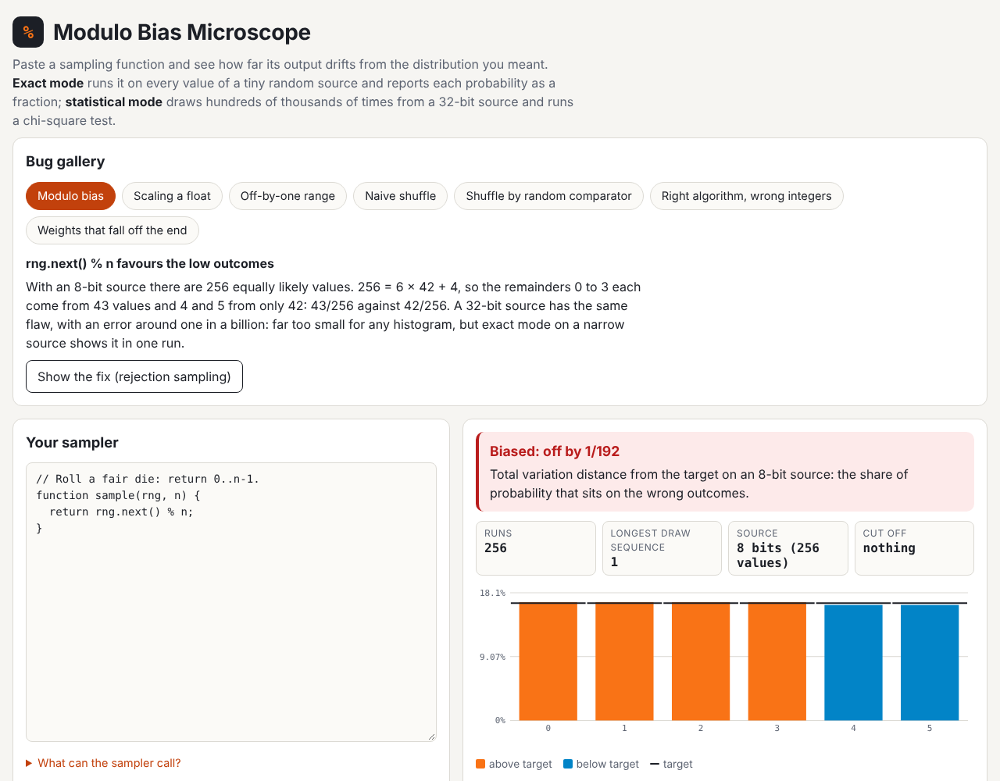

# Modulo Bias Microscope

Paste a sampling function (pick a random element, shuffle, weighted choice)
and see how far its output distribution drifts from the one you meant, both
**exactly** and **statistically**. Randomness bugs pass every example-based
unit test; this makes them visible, and turns "is my shuffle fair?" into
fractions a student can check by hand.

Live: [modulo-bias-microscope.netlify.app](https://modulo-bias-microscope.netlify.app)

Built from idea 2026-10-08 n2 in
[`pisanuw/daily-project-ideas`](https://github.com/pisanuw/daily-project-ideas),
inspired by the Hacker News post "When random is not actually random enough".
The idea's Python support (Pyodide) is left out: samplers are JavaScript.
There is no LLM and no backend; everything runs in the browser.



## The sampler

Students write `function sample(rng, ...args)` and return a value. The
arguments come from a JSON array (`[6]`, `[[0,1,2]]`, `[["rock","paper"], [1, 1]]`).

| Call | Meaning |
|---|---|
| `rng.next()` | uniform integer in `0 … 2^bits − 1` |
| `rng.random()` | `next() / 2^bits`, a float in `[0, 1)` |
| `rng.below(k)` | ideal uniform integer in `0 … k − 1` (an exercise may turn it off) |
| `rng.bits` | source width: chosen in exact mode, 32 in statistical mode |

`Math.random()` is blocked. Return values are compared by their JSON form,
so arrays (shuffles) and strings work; `undefined` and thrown errors are
reported as their own outcomes.

## Exact mode

The sampler is run against a deliberately narrow source (1 to 16 bits,
default 8) once for **every** possible sequence of draws. The enumerator works
like an odometer: run, bump the deepest draw that still has values left,
replay that prefix. Each path has probability `1/(a1·a2·…·ak)`, where `ai` is
the number of values the i-th draw could take, and the sums are BigInt
fractions, so `rng.next() % 6` on 8 bits reports exactly `43/256` for 0–3 and
`42/256` for 4 and 5, a total variation distance of `1/192`.

- **Rejection loops** never terminate on every path. A path is cut once its
  probability would drop below 2⁻³², and the cut-off mass is reported
  separately; the verdict is about the distribution *given that the sampler
  returns*, so correct rejection sampling is reported as exact.
- **Witnesses**: each outcome lists one draw sequence that produces it.
- **Determinism check**: if replaying the same draws makes different calls
  (hidden state between calls), exact mode stops and says so.
- **Budget**: it gives up after 1,000,000 runs with an estimate of the total
  (a 5-element shuffle on 8 bits would need 256⁴ runs), suggesting fewer
  bits or statistical mode.

## Statistical mode

Up to 5,000,000 calls on a seeded 32-bit xoshiro128** stream, then a
chi-square goodness-of-fit test (hand-written regularized incomplete gamma for
the p-value). It shows a histogram against the target, a z score per
outcome, and warns when cells expect fewer than five hits. Any outcome the
target forbids, or any thrown error, fails outright. A call that draws more
than 10,000 times (a loop tuned to an 8-bit source spinning on a 32-bit one)
is stopped and reported as an error.

The two modes teach together: modulo bias is around one part in a billion
on a 32-bit source, so the chi-square test passes it, while exact mode on 8
bits shows the same flaw in one run.

## Bug gallery

| Bug | Broken | Fix |
|---|---|---|
| Modulo bias | `rng.next() % n` | rejection sampling |
| Scaling a float | `Math.floor(rng.random() * n)` | rejection sampling |
| Off-by-one range | `min + rng.below(max - min)` | `max - min + 1` |
| Naive shuffle | swap with any index (27 paths, 6 orders) | Fisher-Yates |
| Random comparator | `a.sort(() => coin flip)` | Fisher-Yates |
| Right algorithm, wrong integers | Fisher-Yates with `next() % (i + 1)` | unbiased index |
| Weights that fall off the end | rounded cumulative floats return `undefined` | integer weights |

For shuffles, a heat map shows the probability of each item landing at each
position.

## Exercises and grading

The instructor panel turns the current editor (arguments, target, bits,
draws, starter code) into an exercise link with a title, prompt, a
false-fail rate and an on/off switch for `rng.below`. The whole exercise is
encoded in the URL fragment, so nothing is stored on a server. The
autograder tries exact mode first (a correct sampler always passes, a biased
one always fails); if enumeration needs more than 300,000 runs it falls
back to the chi-square test, where a correct sampler fails with the stated
probability and small biases can pass. "Copy link" makes a permalink for any
code, for forum posts or office-hours queues.

## Limitations

- JavaScript only. The idea's Pyodide/Python mode is not built.
- Exact mode is exponential in the number of draws: shuffles beyond five or
  six elements need statistical mode or a smaller source.
- The worker is stopped after 30 seconds, which catches loops that never
  draw; it is isolation from the page, not a security sandbox.
- No class dashboard: grades are shown to the student, not collected.

## Development

```bash
npm install
npm run dev        # http://localhost:5173
npm run lint
npm run typecheck
npm run coverage   # 68 tests, thresholds 85%
npm run build
```

Code layout: `src/core/` holds the rational arithmetic, enumerator, PRNG and
statistics, report, gallery, grader and permalink code (all unit-tested);
`src/worker.ts` runs jobs off the main thread; `src/ui/` is the DOM.
