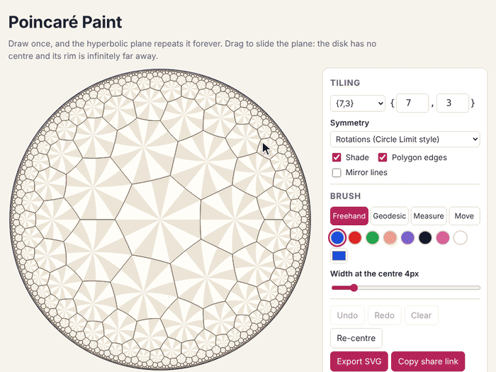
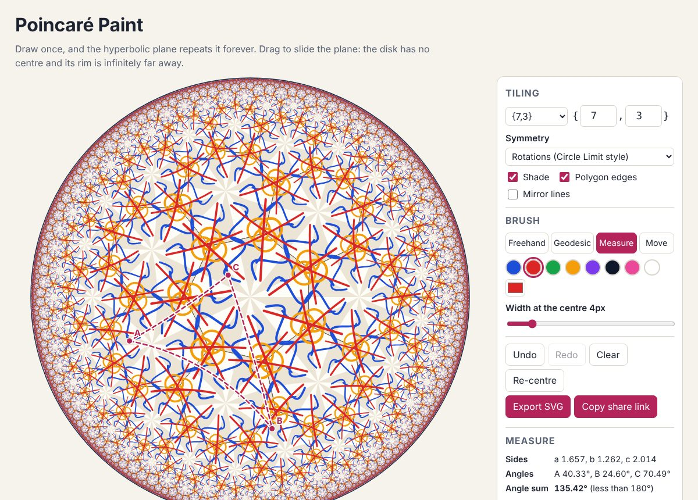

# Poincaré Paint

A drawing toy that lives in the Poincaré disk. Every stroke you make is
copied across a hyperbolic {p,q} tiling straight away, so a doodle turns into
an Escher-style Circle Limit pattern. Drag the plane to re-centre it on any
point: the picture slides, nothing reaches the rim, and every spot turns out
to be as central as any other.

Live: [poincare-paint.pisan.me](https://poincare-paint.pisan.me)



Built from idea 2026-10-10 n1 in
[`pisanuw/daily-project-ideas`](https://github.com/pisanuw/daily-project-ideas).
Everything runs in the browser; there is no backend.



## Using it

- **Tiling.** Pick a preset ({7,3}, {5,4}, {4,5}, {3,7}, {8,3}, …) or type any
  p and q from 3 to 20 with (p − 2)(q − 2) > 4. Changing the tiling keeps
  your strokes and re-tiles them under the new group.
- **Symmetry.** *Rotations* draws each stroke under the orientation-preserving
  half of the group (Circle Limit style); *Kaleidoscope* adds the mirror
  images. Shading, polygon edges and mirror lines can be turned on or off.
- **Brush.** Freehand or Geodesic (drag out a hyperbolic straight line), eight
  colours plus a picker, and a width set in pixels at the centre. Widths are
  stored in hyperbolic units, so copies thin out towards the rim at the right
  rate.
- **Move.** Use the Move tool, Shift-drag, or right-drag to translate the
  plane. Double-click a point to glide it to the centre. Arrow keys move the
  view and 0 resets it when the disk has focus.
- **Measure.** Click two points for their hyperbolic distance, three for a
  triangle with side lengths, angles, angle sum (always under 180°) and area
  (π minus the angle sum). Marks stay put in the plane as you drag, and the
  numbers do not change.
- **Undo / Redo / Clear**, with Ctrl+Z and Ctrl+Shift+Z.
- **Export SVG** writes the current view at 1200 × 1200 with arcs as real SVG
  arcs. **Copy share link** puts the whole drawing (tiling, symmetry, view and
  strokes) in the URL fragment; nothing is uploaded. The last drawing is also
  kept in localStorage.

## How it works

`src/core/` is plain TypeScript with no DOM, and is what the tests cover.

- **Isometries** (`iso.ts`). Every isometry of the disk is
  z ↦ (αz + β)/(β̄z + ᾱ) with |α|² − |β|² = 1, applied to z or to z̄. An
  isometry is stored as α, β and a flag, and products are renormalised onto
  that SU(1,1) form, so long chains of compositions do not drift.
- **Tiling** (`tiling.ts`). The {p,q} polygon centred at 0 splits into 2p
  right triangles with angles π/p, π/q, π/2. Its three mirrors (the real axis,
  the line at angle π/p, and the circle through the edge midpoint orthogonal
  to the rim) generate the group. Tiles are found breadth-first from the
  tile under the screen centre, one mirror step at a time, up to a depth limit,
  and a tile stops spreading once it is smaller than a set number of pixels.
  Tiles are told apart by where they send an interior probe point.
- **Strokes** (`scene.ts`). When a stroke starts, its first point is folded
  into the fundamental triangle by repeated reflection. The same map is applied
  to the whole stroke, which is then stored once, with the parity of that
  fold. Drawing it means mapping its points through view ∘ g for every tile g
  (or only those whose parity matches, in rotation mode). Geodesic strokes are
  drawn as circular arcs orthogonal to the rim.
- **Precision near the rim.** Dragging composes translations into the view.
  After every drag step the view is swapped for view ∘ g, where g is the
  orientation-preserving group element whose tile is under the centre. The
  picture is unchanged, since it is invariant under the group, but the matrix
  stays near the identity. A test drags 300 times (about 360 units of
  hyperbolic distance) and checks the matrix stays small. Without the swap,
  doubles give out after about 18 units.
- **Speed.** Tiles smaller than 8 px draw their sides as chords. Shading is
  filled in batches of 64 triangles, which took one {7,3} frame from 580 ms to
  30 ms in headless Chromium. Stroke copies are grouped by rounded width so
  that one `stroke()` call draws up to 64 of them, and small copies keep only
  every k-th point. During a drag the tiling is cut off at 3 px per tile.
- **Share links** (`share.ts`). A small binary format (version, p, q, flags,
  optional view as four float32, then per stroke the kind, parity, RGB, width
  and zigzag-varint deltas of the points quantised to 1/65536 of the radius),
  base64url-encoded. The decoder rejects bad versions, non-hyperbolic {p,q},
  truncated or trailing data, points outside the disk, and more than 5,000
  strokes or 200,000 points.

## Limitations

- Canvas 2D only; there is no WebGL path, so very deep tilings with many
  strokes get slow on weak devices. The Detail panel trades depth for speed.
- A stroke's width is set once from the metric at its middle point, so a single
  very long stroke does not taper along its length.
- Freehand strokes are polylines through the sampled points, not geodesic
  segments, so a very fast, sparse stroke bends slightly differently in
  copies near the rim.
- Measurement marks are not part of the drawing: they are not shared or
  exported.
- No pinch-zoom: the disk always fills the frame, because Euclidean zoom is
  not a hyperbolic motion. Touch users pan with the Move tool.

## Develop

```bash
npm install
npm run dev        # Vite dev server
npm run lint
npm run typecheck
npm run coverage   # vitest with v8 coverage (core only)
npm run build
```

58 vitest tests, 100% statement coverage of `src/core`. The DOM glue in
`src/ui` was checked by driving the built app in Playwright: drawing, dragging,
measuring, export, share-link round trip, a 390 px phone width with no
sideways scroll, and dark mode.
