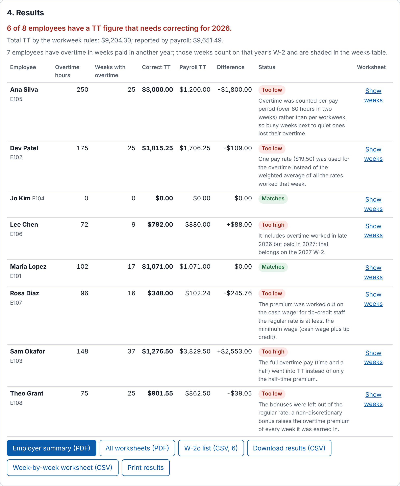

# Qualified Overtime Checker

**Live:** https://qualified-overtime-checker.hintwise.org



From tax year 2026, every W-2 shows the extra half of overtime pay on its own
line: Box 12, code TT. Your staff can deduct only what is reported there, and
a wrong figure means a corrected W-2 (a W-2c). Payroll software often gets it
wrong. It may use one pay rate when someone worked at two, count overtime
per pay period instead of per week, put the whole overtime pay in the box, or
leave a bonus out.

This checker is for **owners of small businesses with hourly staff** and the
**bookkeepers who run their payroll**. It rebuilds every workweek from your
timesheet export, works out the right figure for each employee, compares it
with what your payroll calculated, and tells you who is off, by how much, and
the likely reason.

## How it works

1. **Employer.** Name the employer, choose the tax year and the day your
   workweek starts.
2. **Hours.** Upload a timesheet or time-clock export (CSV). Toast time
   entries and QuickBooks Online "Time Activities by Employee Detail" are
   recognised by their columns; for any other file you pick the columns once
   and the file remembers them. QuickBooks time activities have no pay
   rates, so you type each employee's hourly rate once.
3. **Your payroll's figures.** Type in, or upload, the Box 12 code TT amounts
   your payroll shows (from its W-2 preview or year-end report).
4. **Results.** Each employee's correct figure, the difference, the likely
   cause, and a week-by-week view.

Try the sample employer on the page to see it with made-up data first.

## What you get

- An **employer summary** (PDF): every employee's figure, what to correct
  and why, and how the figures are worked out.
- A **worksheet per employee** (PDF), week by week, whose total is the
  figure. Keep it on file.
- The **W-2c list** (CSV): exactly the employees to correct, the amount your
  payroll shows and the right one. Correct the figure in payroll before you
  file; after filing, each needs a W-2c.
- The results and the worksheet as CSV, and a print view.

## The cases it handles

- Staff on two or more pay rates (the weighted-average regular rate).
- Non-discretionary bonuses and commissions, spread back over the weeks they
  were earned in and reported in the year they are paid.
- Shift differentials, and servers paid a cash wage plus a tip credit (counted
  at the minimum wage you set).
- Weeks that straddle pay periods or the year end (a week counts in the year
  it is paid).
- Overtime your payroll paid short: the figure is what was actually paid, and
  the shortfall is flagged.
- Tips, gifts, discretionary bonuses and expense reimbursements are left out,
  as the rules require.

The method follows the IRS fact sheet FS-2026-13 (6 August 2026) and the
Labor Department's overtime rules (29 CFR 778).

## What it does not do

- It does not connect to your payroll; it reads exports.
- Pay-period totals (two weeks of hours in one row) cannot be checked per
  workweek, and are refused with an explanation. Payroll summaries with no
  dated hours, and EasyACCT's earnings totals, cannot be used.
- It does not cover the FLSA's alternative overtime systems (hospitals'
  8-and-80, public safety under section 7(k), compensatory time), salaried
  staff on a fluctuating workweek, or qualified tips (code TP).
- It does not file anything. This is a worksheet, not tax advice.

## Your data

Each employer is a **client file**. Without signing in, files stay in this
browser only. Sign in with Google or an emailed link to keep them in your
account, so they follow you to another computer; you can move any file back
to "this browser only" at any time.

A saved file holds the employer's name and settings, each employee's name and
ID, their dated hours and pay rates, the rates you typed, and your payroll's
figures. **Social Security numbers are never kept**: a column that holds
them is dropped as soon as the file is read, before any column is matched,
and is never saved or exported. Files in your account are
kept in HintWise's database (Supabase, United States East) and only your
account can read them. The Delete button removes a file at once; to remove
your account and everything in it, email builder@hintwise.org from the
address you signed in with.

The app is free.

## For developers

```bash
npm ci
npm run lint && npm run typecheck && npm run coverage && npm run build
npm run dev   # http://localhost:5173
npm run e2e   # Playwright walkthrough (PW_CHROMIUM=/path/to/chromium if the bundled browser is missing)
```

TypeScript and Vite, with no framework; Supabase for sign-in and saved files;
PDFs written by a small built-in writer. Plan: `docs/PLAN.md`. Handoff:
`HANDOFF.md`.
