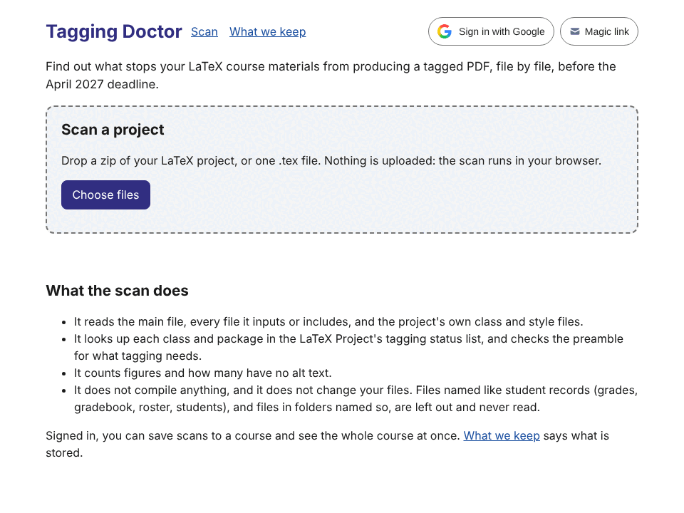

# Tagging Doctor

**https://tagging-doctor.hintwise.org**



Tagging Doctor tells you what stops your LaTeX course materials (lecture notes,
problem sets, exams) from producing a tagged PDF, the kind a screen reader can
follow, and helps you fix it. It is for faculty who write in LaTeX, and for the
accessibility office and instructional designers who support them.

Drop a zip of a project, or one `.tex` file. In a few seconds you see each
class and package that blocks tagging, the file and line where it is loaded,
what the LaTeX Project says about it, and a suggested fix. The scan runs in
your browser: nothing is uploaded for it. Then, if you like:

- **Suggest fixes** makes a copy of your project with the fixes you accept,
  one by one, and a list of what you must change by hand.
- **Alt text for figures** lists every figure, drafts a short description
  for each one you choose, and puts the texts you approve into the copy.
- Signed in, **Compile and check** compiles the project for real and checks
  the PDF against PDF/UA-2, the standard for accessible PDF, and **Compile
  patched and compare** does the same for the copy and shows what got better.
- Signed in, **Save** keeps the scan under a course, so you can see the whole
  course at once and print a course report for your accessibility office.

## How to use it, in four steps

1. **Drop your project.** Zip the folder that holds the main `.tex` file and
   everything it reads, and drop it on the page (or choose it with **Choose
   files**). A zip of a whole course lists its documents: pick one, or choose
   **Scan all** for one row per document.
2. **Read the result.** Blockers first, then warnings. **Download report**
   gives you one HTML file to hand to your accessibility office.
3. **Fix a copy.** Choose **Suggest fixes**, accept the fixes you want, write
   or draft alt text under **Alt text for figures**, and choose **Download
   patched zip**. The copy comes with `tagging-doctor.diff`, which shows every
   line that changed. Your own files are never changed.
4. **Check and keep it.** Sign in (Google, or a link by email), choose
   **Compile and check** or **Compile patched and compare**, and **Save** the
   scan to a course. Save a new version of a project under the same name to
   see how many blockers were fixed and how many are new; your approved alt
   texts come back for every figure whose file has not changed. **My
   courses** lists your courses; a course's **Course report** is a printable
   page with each project's verdict, its latest check and its alt text.

## What the scan checks

- Every file the main file reaches: `\input`, `\include`, `\subfile`,
  `\import`, `\subimport`, `\InputIfFileExists`, and your own class and style
  files (a shared `course.sty` is read too, with what it loads).
- Each class and package, against the LaTeX Project's tagging status list:
  blockers (no support, or not yet compatible), warnings (works in part),
  unknown (not checked, or not in the list; never shown as fine), and those
  that work.
- The preamble: whether `\DocumentMetadata` is there and comes first, the
  pdfTeX-only `inputenc` and `fontenc`, the document language and a title.
- Figures: how many `\includegraphics` and `tikzpicture` uses have no alt text.
- Parts that need a program outside TeX (EPS figures, `svg`, `minted`,
  `pythontex`, `gnuplottex`, `\tikzexternalize`).

## The fixes

Each fix is a card that says what changes and why. You accept or skip each
one; nothing changes until you download the copy.

- The `\DocumentMetadata` line that turns tagging on, for PDF/UA-2, in your
  document's language (from `babel` or `polyglossia`, or one you choose).
- Compiling with LuaLaTeX, and removing `inputenc` and `fontenc`, which only
  pdfLaTeX needs; `unicode-math` when you want it.
- A package swap only where it has been tested to compile tagged.
- Everything else, such as a blocking package with no tested replacement, is
  listed under **Needs your attention**, with the file, the line and advice.

## Alt text for figures

- Each figure shows its file, place, caption, the text around it and a
  preview. **Draft** asks a model for a short description; **Draft all**
  drafts every figure that has none yet. Check every draft: you approve each
  text, or mark the figure **Decorative** (screen readers skip it) or **Skip**.
- Drafts use your own Anthropic key, if you paste one (it stays in this
  browser), or, when you are signed in, HintWise's key within a small daily
  allowance; the panel says about how many drafts are left today.
- PDF, EPS and TikZ figures are drafted from the text around them only.

## What it does not do

- It does not certify a document. "No known blockers" means none of
  the packages it found is listed as a problem; only a compile with tagging on
  and a PDF/UA check can show how the PDF turns out, and no checker can judge
  everything a reader needs, such as whether an alt text describes a figure
  well.
- It does not change your files. Fixes go into a copy you download.
- **Beamer slides:** Beamer cannot be tagged today; the LaTeX Project
  recommends the `ltx-talk` class for tagged slides. Tagging Doctor does not
  move slides to another class, and the copy of a Beamer deck gets no
  `\DocumentMetadata` line (Beamer stops with it). Alt texts still go in.
  The same holds for six other classes the LaTeX Project lists as not
  supported (`novel`, `powerdot`, `prosper`, `seminar`, `tufte-book`,
  `tufte-handout`).
- **Equations:** the inserted line tags each equation as MathML, which a
  screen reader can read. Tagging Doctor does not check how your notation is
  spoken (whether `f'` is read as "f prime" or "the derivative of f"), and it
  does not suggest the markup (`\MathMLintent`) that would say so.
- Many common packages (`caption`, `pgfplots`, `algorithm2e`, `minted`) are
  blockers today, and others (`amsmath`, `hyperref`, `tikz`) work only in part,
  so most real course documents will show "N blockers found". That is the
  honest state of tagging in LaTeX, and it changes as the LaTeX Project updates
  its list.

## What is stored

- Your files are never stored. Files named like student records (`grades`,
  `gradebook`, `roster`, `students`, any extension), and every file in a folder
  named so (`grades/`), are left out of the scan and never read; remove them
  from course folders. If such a folder holds course material, not student
  records, rename it and drop the zip again.
- When you sign in and save, the app keeps your courses, the project names and,
  for each saved scan, its verdict and counts and, per finding, the file path,
  the line, the package name and an excerpt of at most 200 characters. For a
  saved scan it also keeps each alt text you approve (or a Decorative mark),
  the figure file's path and a fingerprint of the file, never the file. All of
  it is kept in HintWise's database at Supabase (US East) until you delete it.
- **Export my data** (on My courses) downloads all of it as one file.
  Delete a project or a course from its page. **Delete my account**, in the
  panel under your name, deletes your sign-in and what every HintWise app keeps
  for you.
- **Compile and check**, when you are signed in, sends the project's files
  (only the types the checker uses, never a student record) to the HintWise
  checker on Render in the US (region oregon), which compiles them with
  LuaLaTeX, checks the PDF with veraPDF and deletes everything within 30
  minutes. For a saved scan the app keeps the check's status, times, page
  count, warnings and the PDF/UA failures by clause, never the PDF or your
  files. Upload only materials you wrote or may change.
- **A figure draft** sends the figure's image (PNG, JPEG, GIF or WebP, made
  smaller first if it is large), its file name without folders, its caption
  and label, and the text around it to Anthropic, only when you choose Draft
  or Draft all: straight from your browser with your own key, or through
  HintWise's gateway with HintWise's key.
- Visits are counted without cookies. The app's **What we keep** page says
  the same in full.

## Compile and check

Signed in, **Compile and check** runs a real compile and a PDF/UA-2 check:

- the page count, the compile time and the LaTeX warnings, or, when the
  project does not compile, the first error in plain words with its file and
  line, and the last 50 lines of the log;
- whether the PDF passed veraPDF's PDF/UA-2 check, with the profile and the
  veraPDF version, and the failures grouped by clause of the standard, the
  most frequent first, in plain words.

**Compile patched and compare** checks the original and the copy with your
accepted fixes and alt texts, and shows each clause side by side: fixed,
unchanged or new. If the copy does not compile, you can turn one fix off and
compile again to find the one that stops it.

The checker runs on HintWise's shared server, so a check usually starts at
once ("Waking the checker" shows only right after the server restarts). One
check runs at a time, at most five per person an hour, and each stops after
two minutes. A restart of the server deletes the checks and PDFs it holds.
The checker runs no outside programs (EPS conversion, `minted`, `pythontex`).

## Limits

- A zip of at most 20 MB, 2000 files and 100 MB unpacked. Password-protected
  zips cannot be read. The checker takes at most 25 MB.
- **Document size:** the test document `math-notes` (22 pages of lecture
  notes with equations, two TikZ pictures, two figures and `titlesec`)
  compiles with tagging on and is checked in about 40 seconds on the live
  checker. A document of about that size fits in the two-minute limit; a much
  longer one (a whole book of notes) may not, so check it chapter by
  chapter.
- The fixes do not make every document pass PDF/UA-2. `math-notes`, patched
  with the default fixes, goes from 4,785 failed checks in 9 rules to 181 in
  one: clause 8.2.2 of ISO 14289-2 ("content that is neither tagged nor
  marked as an artifact"), from the TikZ pictures and the partly compatible
  `titlesec`. Those need work by hand (alt text and the tagging project's
  advice for each package).
- Alt texts come back on a new version of a project only for a figure whose
  file is unchanged; a renamed file counts as a new figure. One image used
  several times keeps a text for each use, matched by its place. When a use
  is removed from the middle, the texts after it are not filled in (the app
  cannot tell which use went); they stay in your saved project.
- Drafts on HintWise's key are limited each day, for each person and for the
  app as a whole; your own key has no such limit.

## Credits

The package and class data is a converted copy of the LaTeX Project's
[tagging status list](https://latex3.github.io/tagging-project/tagging-status/),
under the LaTeX Project Public License, version 1.3c or later. The copy's
date, commit and source are on every report.

## For developers

Vite and TypeScript, no framework. The scan is pure TypeScript in `src/core/`:

| File | What it does |
|---|---|
| `zip.ts` | Reads the zip's directory, checks the limits, inflates one entry at a time with a hard stop at its declared size |
| `project.ts` | Which entries may be read (no `..` paths, no student records); reads text lazily |
| `latex.ts` | Comments, commands, arguments, paths |
| `scan.ts` | Main-file detection, the file walk, the status lookups and the preamble checks |
| `status.ts` | The status data and its mapping to groups |
| `report.ts` | The HTML and JSON downloads (`schema/report.schema.json`) |
| `outzip.ts` | The one place that builds a zip of a project (the checker's upload and the patched copy) |
| `patch.ts` | The fix cards, the copy with the accepted fixes and approved alt texts, and its diff |
| `figures.ts` | The figure list for alt text, and where each text goes in the source |
| `compare.ts` | The two checks of "Compile patched and compare" side by side, clause by clause |
| `compile.ts` | What goes to the checker, its answer in plain words (`src/data/verapdf-rules.json`), and the saved job row |
| `saved.ts` | What a saved scan holds, the rescan delta, the course report and the export |

Saved data goes through `src/lib/store.ts` (`CourseStore` over a `Db`: Supabase
in the schema `app_tagging_doctor` live, in memory for tests and `vite
preview`). The schema is `supabase/migrations/0001_init.sql`; `test/schema.test.ts`
runs it on PGlite and checks row level security, the composite keys and the
cascades. Without the Supabase env (`vite preview`, `npm run e2e`) sign-in is a
stand-in that signs a preview person in (`src/ui/preview-account.ts`).
The checker (`tagging-doctor-worker/`, mounted in `backend-hub/` at
`/tagging-doctor`) is called by `src/lib/checker.ts` at `VITE_CHECKER_URL`;
"Compile and check" shows only when `VITE_COMPILE_CHECK` is `on`, and
"Compile patched and compare" only when `VITE_COMPARE_PATCHED` is `on`
(`.env.example`, `deploy/target.yml`). The walkthrough builds with a
stand-in address and answers the checker's routes itself.

Alt-text drafts (`src/lib/draft.ts`, `src/lib/llm.ts`) go from the browser
to Anthropic with the person's own key, or through the HintWise LLM gateway
(the platform's `llm-gateway` function, app `tagging-doctor`, its default
daily caps) for a signed-in person without a key. Approved texts are saved in
`alt_texts` and restored on a new drop by the file's SHA-256
(`src/lib/alts.ts`).

```bash
npm ci
npm run lint && npm run typecheck && npm run coverage && npm run build
npm run e2e        # Playwright against vite preview, axe-core included (e2e/a11y.spec.ts)
npm run test:image # the checker's own tests on backend-hub's Docker image (needs Docker)
```

`npm run typecheck` and `npm run test:image` need the monorepo
(pisanuw/claude-built-apps): `image-test/` uses the checker's test harness in
`../tagging-doctor-worker/`. In the pisan-labs mirror, which holds this folder
alone, type-check with `npx tsc -p tsconfig.json --noEmit`; the unit tests that
read the checker's fixtures are skipped there.

The status data is a converted copy of `latex3/tagging-project`'s
`_data/tagging-status.yml` (`src/data/tagging-status.json` holds its commit and
date).

To refresh the status data from a newer commit of the list:

```bash
git ls-remote https://github.com/latex3/tagging-project refs/heads/main
curl -o /tmp/ts.yml https://raw.githubusercontent.com/latex3/tagging-project/<commit>/_data/tagging-status.yml
npm run status-data -- /tmp/ts.yml <commit> <YYYY-MM-DD>
```

Fixtures for the tests are small projects in `test/fixtures/`; the tests zip
them on the fly.
