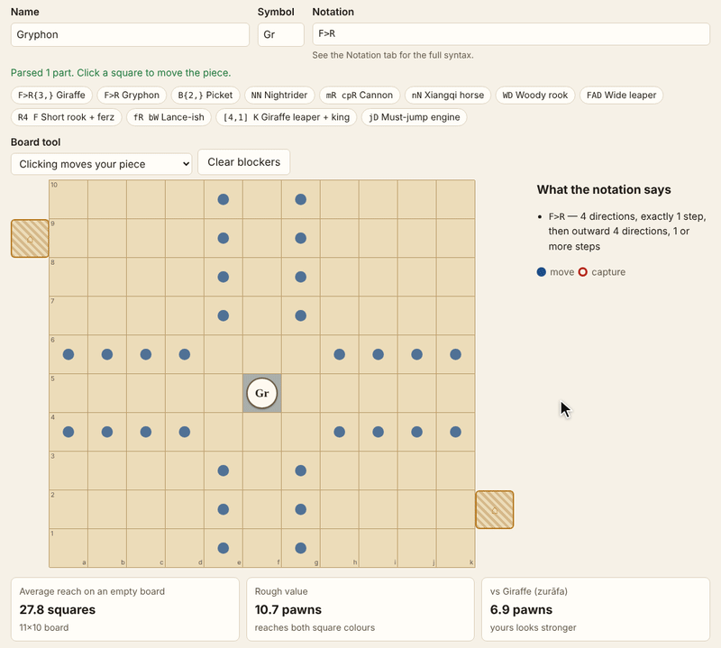
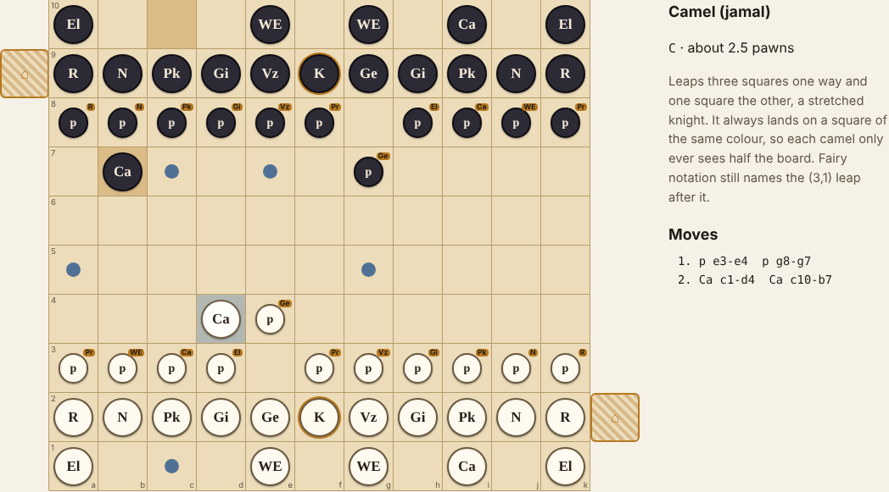

# Tamerlane Board

Timur's chess (Tamerlane chess), the fourteenth-century variant with
giraffes, war engines and citadels, playable in the browser against a small
engine. Every piece, the historical ones included, is one line of a
Betza-like movement notation, so the move generator, the highlight overlay
and the engine read the same definitions. A piece lab lets you write a new
piece, watch where it reaches, drop it into Timur or classic chess and play
it, or have the engine play itself to see whether the piece is too strong.

Live: [tamerlane-board.hintwise.org](https://tamerlane-board.hintwise.org)



Built from idea 2026-10-15 n1 in
[`pisanuw/daily-project-ideas`](https://github.com/pisanuw/daily-project-ideas),
prompted by a Show HN post about Timur's chess. The idea's optional Claude
API step (turning plain English into notation) is left out: there is no
backend, and the lab offers clickable examples and a syntax table instead.



## The four tabs

**Play.** Timur chess on its uncheckered 11×10 board, with each player's
citadel sticking out beside their second rank. Play White or Black against
the engine, both sides yourself, or watch the engine play itself. The engine
gets 0.3 to 6 seconds a move. Click a piece to see its legal moves, its
notation, its estimated value and a short history note. The game list also
offers simplified classic chess and the current lab variant.

**Piece lab.** Type a name, a one- or two-character symbol and a notation
such as `F>R{3,}` (the giraffe) or `mR cpR` (a xiangqi cannon). The board
shows every square the piece reaches, animated outward by distance, and a
board tool places friendly or enemy blockers so you can check lame leaps,
must-jump moves and hoppers. Readouts give the average reach on an empty
board, a rough value in pawns, and how that compares with the piece it would
replace. Then:

- **Play it against the engine** swaps it in for both sides.
- **Balance test** plays six fast engine-vs-engine games with your piece on
  one side only, alternating colours, and reports the points it scored.
- **Copy share link** puts the whole spec in the URL (`#lab=…`; `#play=…`
  opens straight into a game).

**The pieces.** One card per historical piece: its reach from the centre of
an empty board, its notation, its value estimate and a note on where it came
from (the ferz that became the queen, the alfil that became the bishop, the
dabbaba's name surviving as the fairy D leap).

**Notation & rules.** The full notation syntax and the rules as implemented.

## The notation

A small dialect of Betza's funny notation:

| Write | Meaning |
|---|---|
| `W F D N A H C Z G` | Leaps (1,0) (1,1) (2,0) (2,1) (2,2) (3,0) (3,1) (3,2) (3,3) in every direction |
| `K`, `[x,y]` | One step any way; any other leap |
| `R B Q`, `NN` | Riders; a doubled atom rides that leap |
| `R4`, `B{2,}`, `W{1,3}` | Maximum distance; minimum and maximum |
| `F>R{3,}` | One step to an empty square, then slide outward |
| `m c` | Move only, capture only |
| `f b l r s v` | Forward, backward, left, right, sideways only, vertical only |
| `n j p i` | Lame (path must be empty), must jump, hopper, only from the starting rank |

The historical pieces: king `K`, general `F`, vizier `W`, giraffe
`F>R{3,}`, picket `B{2,}`, knight `N`, rook `R`, elephant `A`, camel `C`,
war engine `D`, pawns `mfW cfF`. Classic chess's pawn is `mfW cfF imfnD`.

## How it works

- `src/core/notation.ts` parses notation into rules (legs, ranges,
  modifiers) and reports errors with a position.
- `src/core/rules.ts` compiles each piece, once per variant, into rays for
  every colour and square: a path of squares plus a mode (slide, jump, hop)
  and where landing may start. Only a royal piece may enter a citadel, and
  only the opponent's.
- `src/core/game.ts` holds the board as an `Int16Array`, makes and unmakes
  moves, generates pseudo-legal and legal moves, tests check, and scores the
  result (checkmate, stalemate per variant, citadel draw, move limit).
- `src/core/engine.ts` is a negamax alpha-beta search with iterative
  deepening, capture-only quiescence, MVV-LVA and killer ordering. Inside the
  tree it treats capturing the royal piece as the win, so checkmate and
  stalemate fall out of the search. Evaluation is material plus small
  centrality and pawn-advance terms. It runs in a Web Worker.
- `src/core/value.ts` estimates a value from mobility: the average number of
  squares reached on an empty board, mapped so the 8×8 knight (5.25) is
  about 3 pawns and the queen (22.75) about 9, with one-sided rays counted
  half and a 15% discount for colour-bound pieces.
- `src/core/lab.ts` builds a variant from a lab spec and encodes share
  links; `src/core/selfplay.ts` runs the balance-test games.

## Rules as implemented (and what is simplified)

Timur chess rules follow the Wikipedia summary of Tamerlane chess, which
draws on H. J. R. Murray's *A History of Chess* (1913). Black's setup is
White's rotated half a turn, so each vizier stands on its king's right. The
citadel beside each player's own second rank is theirs; a king that steps
into the opponent's citadel ends the game as a draw (historically the player
could claim one). Checkmate wins and stalemate is a loss for the stalemated
side. Pawns have no double step and no en passant and promote to the piece
they are named for.

Left out or simplified:

- The king's once-per-game swap with another piece, and the citadel swap.
- Extra royal pieces: the prince (from the pawn of kings) moves like a king
  but is an ordinary piece, and there is no adventitious king.
- The pawn of pawns' three-stage promotion: it promotes straight to a prince.
- No repetition or fifty-move rule (as historically). The balance test caps
  games at 120 plies and adjudicates on material.
- Classic chess has no castling or en passant and always promotes to a queen.
- Which citadel belongs to whom is not stated in the sources consulted; the
  app's reading (a king runs to the far citadel) is an interpretation.
- Notation: direction letters filter whole directions, and only one second
  leg (`>`) is supported.

The piece values are the app's mobility heuristic, not historical figures.
Six balance-test games at a shallow depth are a hint, not a verdict.

## Develop

```bash
npm install
npm run dev        # Vite dev server
npm run lint
npm run typecheck
npm run coverage   # 82 vitest tests; thresholds 85%
npm run build
```

The core (`src/core`) is covered by unit tests: about 99% of statements. The
DOM code in `src/ui` was checked in Chromium with Playwright at desktop and
phone widths.

No environment variables are needed (see `.env.example`). It deploys to
Netlify as a static site via `deploy/target.yml`.
