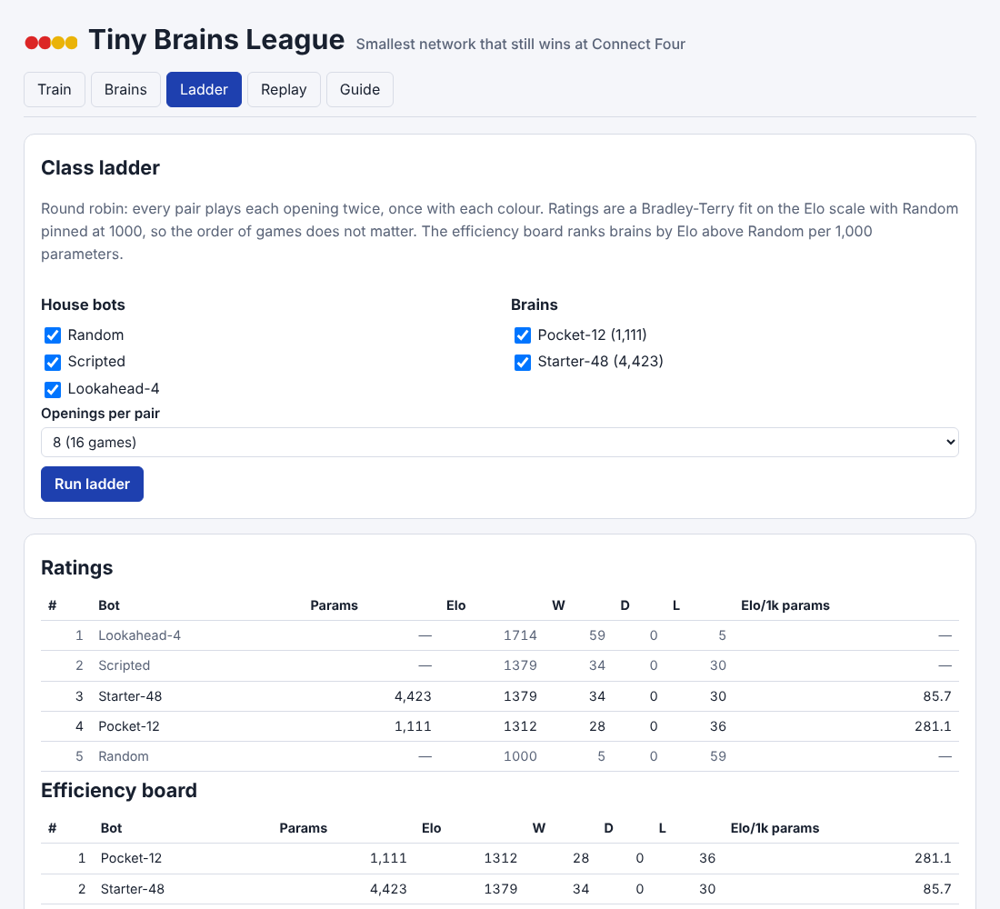

# Tiny Brains League

A classroom assignment kit for a multi-week ML project: train the smallest
neural network you can to play Connect Four, under a hard budget of 5,000
weights and biases, then climb a class ladder where Elo is weighed against
parameter count.

Live: [tiny-brains-league.pisan.me](https://tiny-brains-league.pisan.me)

Built from idea 2026-09-26 n3 in
[`pisanuw/daily-project-ideas`](https://github.com/pisanuw/daily-project-ideas).
The idea suggested a Flask ladder server, a React replay viewer and Supabase
for submissions; this build is a static TypeScript app instead. Training,
the ladder and replays run in the browser, and the instructor runs the
official ladder by loading every student's weight file into one browser.



## The five tabs

**Train.** Pick hidden layer sizes (up to three layers), relu or tanh, and
a seed. A meter shows the parameter count against the budget. Two methods,
usable alone or in sequence:

- *Imitation.* Generates teacher-vs-teacher games with a chance of random
  moves (so the data covers positions the teacher would never reach),
  labels every position with every column the teacher considers best, adds
  left-right mirror images, and trains with Adam on the cross-entropy of a
  softmax restricted to legal columns. Teachers: the scripted bot,
  Lookahead-2, or Lookahead-4 (slow).
- *Evolution.* Truncation-selection evolution strategy with Gaussian
  mutation. Fitness is points against Random (and optionally Scripted) over
  fixed openings, plus a small bonus for each of five fixed tactics
  positions (win now, or block now) the net gets right. It can start from a
  fresh net or fine-tune an imitation-trained one.

Each epoch reports loss, teacher agreement and a quick check against the
house bots. Finished brains are saved to the Brains tab and can be
downloaded. Every run is logged with its settings and scores, and the log
exports as a Markdown ablation table (with a stub for the "what the budget
forced me to give up" paragraph) or CSV.

**Brains.** Submit weight files (choose files or paste JSON). Files are
validated against the interface and the budget, and a rejected file lists
every problem. Each brain shows its three milestones: score at least 90%
against Random, score above 50% against Scripted (32 games each, 16 fixed
openings with both colours), and its rank on the last ladder. Two sample
brains ship with the app.

**Ladder.** Round robin among any mix of house bots and brains. Every pair
plays each fixed two-ply opening twice, swapping colours. Ratings are a
Bradley-Terry maximum-likelihood fit on the Elo scale (draws count half),
so the order games are played in does not matter; one virtual win and loss
against a 1500 phantom keeps a perfect record finite, and the table is
shifted so Random is 1000. The efficiency board ranks brains above Random
by Elo above Random per 1,000 parameters. A head-to-head matrix opens the
game list for any pair, and results download as JSON.

**Replay.** Step through any ladder game. For a network player the
probabilities it gave each column are drawn above the board. Each ply is
checked for a missed win, a missed block, or a move that lets the opponent
win by playing on top; flagged moves are listed in red.

**Guide.** The assignment, the exact interface, the scoring rules and a
download of the Python runtime.

## The interface

A brain is a multilayer perceptron stored as JSON:

```json
{
  "format": "tiny-brains/v1",
  "name": "pocket-brain",
  "activation": "relu",
  "layers": [
    { "weights": [[84 numbers], ... 12 rows], "bias": [12 numbers] },
    { "weights": [[12 numbers], ... 7 rows], "bias": [7 numbers] }
  ]
}
```

- Input: 84 numbers from the point of view of the side to move. Entries
  0–41 are 1 where the mover has a piece, 42–83 where the opponent has one.
  Cell `i` is row `floor(i / 7)` (row 0 is the bottom) and column `i % 7`.
- Hidden layers apply the activation; the last layer is linear and has 7
  outputs, one per column.
- The runtime plays the legal column with the highest logit, the lowest
  column on ties. There is no search at play time and no student code runs.
- 1 to 4 layers, at most 5,000 parameters, finite weights within ±1000,
  file under 1 MB.

## House bots

| Bot | What it does |
|---|---|
| Random | Uniform over legal columns. |
| Scripted | Wins if it can, blocks if it must, avoids playing under an opponent win, then takes the best one-ply score of open windows (2 and 3 in a row) and centre pieces. Ties broken at random. |
| Lookahead-4 | Depth-4 negamax with alpha-beta on the same evaluation. |

House bots break ties with a PRNG seeded from the pairing and the opening,
so a ladder rerun gives the same games.

## Python runtime

[`python/tiny_brains.py`](python/tiny_brains.py) (NumPy only) has the same
board, encoding, forward pass and move rule, a validator, a `save_brain`
helper and a quick check against a random mover:

```bash
python python/tiny_brains.py check my-brain.json
python python/tiny_brains.py parity test/fixtures/parity.json   # 131/131 positions match
```

The parity fixture (131 positions from a sample brain, with the logits and
move the TypeScript runtime produced) is checked by the vitest suite and by
the Python script, so a network trained in Python plays the same on the
ladder.

## What a budget buys

From the two sample brains (imitating Scripted, seeds fixed, see
`npm run samples`):

| Brain | Hidden | Params | vs Random | vs Scripted |
|---|---|---|---|---|
| Pocket-12 | 12 | 1,111 | 75% | 28% |
| Starter-48 | 48 | 4,423 | 91% | 47% |

In a 16-game-per-pair ladder with the house bots, Starter-48 rated about
1380 (level with Scripted) and Pocket-12 about 1310, so Pocket-12 tops the efficiency board. A
policy this small learns centre play and some threats but still misses
tactics a one-ply check would catch, which is the point of the exercise.

## Limitations

- No server: brains, the experiment log and ladder results live in one
  browser's storage. There are no accounts or shared submissions, and the
  official ladder is whatever the instructor runs locally.
- Training is single-threaded JavaScript. Large datasets, Lookahead-4
  teachers and long evolution runs take minutes; serious training belongs in
  Python (PyTorch is not needed but works fine with `save_brain`).
- One game (Connect Four 7×6) and one input encoding. Self-play training is
  not built in.
- Milestone scores come from 32 games, so a brain near a threshold can pass
  or fail on small changes.

## Develop

```bash
npm install
npm run dev        # Vite dev server
npm run lint
npm run typecheck
npm run coverage   # 46 vitest tests, 100% statement coverage on src/core
npm run build
npm run samples    # retrain the two sample brains (about a minute)
npx vite-node scripts/make-parity.ts   # regenerate the parity fixture
```

The core (`src/core`) is plain TypeScript with no DOM: the engine, network
runtime and validator, house bots, matches and ladder, training, replay
annotation, milestones and the experiment log. `src/ui` is the DOM layer;
training, evaluation and ladder runs happen in a Web Worker.
